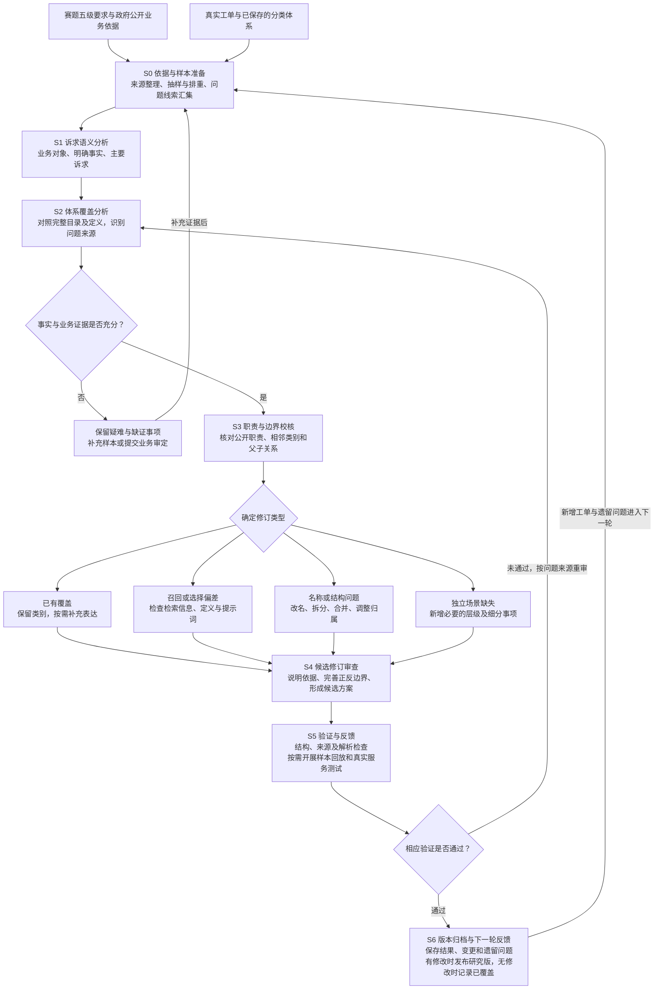

# 12345热线五级分类体系建设报告

[仓库首页](README.md) · [技术报告](分类体系构建依据与数据驱动优化报告.md) · [迭代流程图](分类体系构建与迭代流程图.md) · [参考来源](参考来源与引用说明.md)

**参赛题目：** 基于大模型的12345热线五级分类体系标准化与智能优化  
**项目名称：** 基于多模型协同与层级约束的12345热线五级分类体系构建及智能优化  
**编制日期：** 2026年10月29日  
**成果范围：** 五级分类标准体系的构建依据、数据应用、完善方法及阶段成果

## 摘要

12345热线工单既承载群众的具体诉求，也连接政府部门的业务职责。同一事项可能存在不同表达，同一段文字也可能包含多个问题。要实现稳定、可解释的智能分类，需要先明确业务对象、层级含义和类别边界，再将分类标准应用于模型推理。

本项目围绕赛题提出的“一级行业职能—二级处室职责—三级诉求事项—四级表现情形—五级细分事项”，结合北京市政府公开职责资料、接诉即办相关材料及多城市真实工单，逐步构建和完善五级分类体系，并以多阶段大模型辅助审校框架组织持续修订。建设过程中，先形成数据驱动的分类原型，再通过层级校正、职责溯源和真实样本审阅，持续处理类别混合、边界交叉、名称不准确及场景覆盖不足等问题。

截至报告编制日，最新研究版形成 **23个一级节点、237个二级节点、387个三级节点、492个四级节点和869条完整五级路径**，其中868条为业务分类路径，1条为人工复核路径。项目同时形成类别定义、纳入与排除范围、典型示例，使分类目录不仅能够表达业务，也能够作为智能分类的约束依据。

本报告所述成果聚焦于数据驱动的分类标准建设与模型应用研究。体系通过对真实工单的深入挖掘与公开业务依据的严谨校准，构建了一套标准化且具备业务可解释性的智能分类体系。

## 一、建设目标与业务定位

本项目的建设目标，是把群众自然语言描述的诉求，转化为具有统一含义、明确层次和可解释边界的业务分类。

在热线场景中，仅依据关键词分类容易出现两类偏差：一是把不同办理事项放入同一个宽泛类别，例如将证书报考、证书领取和持证补贴混为一类；二是把同一业务的不同说法建立成多个重复类别，使分类结果随措辞变化。五级体系需要同时解决这两类问题，使上层能够归纳职责和事项，下层能够表达具体表现与办理需求。

围绕这一目标，项目重点开展三方面建设：

1. **统一分类语义。** 明确五个层级各自表达什么，避免把行业、机构、事项和问题表现混在同一层。
2. **增强场景覆盖。** 以真实诉求发现遗漏事项，兼顾高频民生问题与有明确业务意义的长尾场景。
3. **建立持续完善机制。** 对新增工单既检查是否需要扩类，也检查既有名称、定义和边界是否需要调整，使体系能够随业务变化持续维护。

分类结果用于辅助业务识别、工单归类和统计分析。实际派单还需要结合属地、权责清单及承办规则，不能仅凭分类标签认定某个市级处室是唯一办理单位。

## 二、构建依据与数据基础


### 2.1 以赛题规定明确五级结构

赛题材料明确提出行业职能、处室职责、诉求事项、表现情形和细分事项五个层级，并要求面向口语化文本、边界模糊、长尾类别和新增诉求开展智能分类。项目将这一结构作为分类设计的基本约束，类别名称和父子关系均围绕各层级的业务含义审阅。

### 2.2 以北京公开资料校准业务范围与职责

项目参考《北京市接诉即办工作条例》所体现的职责导向和动态维护要求，将诉求分类与职责依据相联系，并保留进一步核对承办关系的空间。该条例涉及职责分工、派单目录及目录调整，为分类体系的业务定位提供制度背景。[《北京市接诉即办工作条例》](https://zwfwj.beijing.gov.cn/zwgk/2024zcwj/202405/t20240510_3670139.html)

对于覆盖范围，项目参考北京12345年度数据分析报告中的市场管理、劳动和社会保障、住房、公共服务、城乡建设等业务名称，检查重要民生领域是否得到体现。年度统计提供的是领域和主题参照，项目并未将其统计层级直接当作完整五级目录，也未按其类别数量机械扩展。[北京12345市民服务热线2025年度数据分析报告](https://www.beijing.gov.cn/hudong/jpzt/2025ndsjbg/index.html)

对于二级职责，项目结合已收集的部门处室资料，进一步查阅政府网站的机构职责、业务单位说明和办事指南。不同资料承担不同作用：机构职责帮助确定管理范围，办事指南帮助区分具体办理事项，公开业务通知帮助核对名称和流程。

政府职责资料可由以下公开入口查询：[市市场监管局机构职权](https://scjgj.beijing.gov.cn/jgzq/)、[市人社局机构设置](https://rsj.beijing.gov.cn/xxgk/zfxxgk/jgxx/)、[市卫生健康委内设机构](https://wjw.beijing.gov.cn/wjwh/ztzl/zqgs_1/nsjg/)、[市民政局组织机构](https://mzj.beijing.gov.cn/col/col243/index.html)、[市教委内设机构](https://jw.beijing.gov.cn/xxgk/zfxxgkml/zwgkjgzn/zwgknsjg/)、[市水务局内设机构](https://swj.beijing.gov.cn/zwgk/jgxx/nsjg/)、[市政务服务和数据管理局机构设置](https://zwfwj.beijing.gov.cn/zwgk/qzxx/jgsz/)。这些入口用于定位职责正文；具体类别依据还需结合对应业务页面核查。完整22部门入口及资料限制见[本报告参考文献与来源](参考来源与引用说明.md)。

### 2.3 以北京本地与多城市真实诉求补充场景

项目形成了以北京场景为重点、其他城市工单为补充的数据基础。北京数据用于观察本地诉求和业务表达；三亚等地数据用于扩大场景发现范围，识别仅凭少量本地样本难以发现的细分事项。


| 数据来源文件                                                                                        | 有效数据行数      | 主要作用                 |
| --------------------------------------------------------------------------------------------- | ----------- | -------------------- |
| [三亚12345工单数据](https://opendata.pku.edu.cn/dataset.xhtml?persistentId=doi:10.18170/DVN/XU3Q4W) | 184,568     | 高频事项、长尾场景和易混诉求挖掘     |
| [北京市委书记留言板](https://liuyan.people.com.cn/threads/list?fid=539)                                | 3,204       | 北京本地民生诉求及跨部门事项补充     |
| [北京市市长留言板](https://liuyan.people.com.cn/threads/list?fid=540)                                 | 1,191       | 本地办理需求和问题表现校准        |
| 北京领导留言板样本                                                                                     | 2,585       | 北京场景审阅和边界分析          |
| [北京12345公开来信](https://www.beijing.gov.cn/hudong/hdjl/sindex/hdjl-xjxd.html)                   | 212         | 政策咨询、资格条件和办理流程分析     |
| [福州12345公开数据](https://fz12345.fuzhou.gov.cn/#/fujianAppealPubilc?rigion=publish)              | 701         | 跨城市场景与不同表达方式补充       |
| [上海12345公开数据](https://www.sh12345.gov.cn/#/demands)                                           | 7,248       | 民生业务范围和类别边界补充        |
| **合计**                                                                                        | **199,709** | **用于建立场景发现与验证的数据基础** |


上述数量依据2026年10月28日文件盘点，同源CSV、JSONL及明显重复副本未重复计入；

多城市数据的使用遵循“迁移业务场景、核对本地职责”的原则。例如，外地工单反映的社保卡补领或补贴未到账问题，可以支持通用场景的识别；其地方机构名称、历史补贴金额和办理条件则不直接写入北京分类标准。由此减少类别对单一城市措辞的依赖，同时保留北京业务依据。

## 三、五级体系的设计方法


### 3.1 明确各层级的业务作用

体系采用由上层约束业务范围、由下层表达具体诉求的组织方式。


| 层级     | 核心含义              | 设计重点                   |
| ------ | ----------------- | ---------------------- |
| 一级行业职能 | 诉求所属的行业或公共服务领域    | 保持相对稳定，避免同义领域重复        |
| 二级处室职责 | 与事项相关的标准业务职责      | 结合公开机构及职责资料建立依据        |
| 三级诉求事项 | 群众要办理、解决或反映的业务对象  | 将相同业务对象下的表现情形归在一起      |
| 四级表现情形 | 该业务中发生的问题状态或办理情形  | 体现具体业务差异，不统一套用投诉、咨询、建议 |
| 五级细分事项 | 在该情形下需要进一步区分的具体诉求 | 依靠工单事实判断，具有清晰的纳入与排除边界  |


例如，当前体系将残疾人补贴中的发放状态与资格复核组织为：

```text
民政与残疾人服务
└─ 残疾人福利补贴管理职责
   └─ 残疾人福利补贴
      └─ 补贴发放状态与资格复核问题
         ├─ 残疾人补贴发放时间及未到账查询
         └─ 残疾人补贴停发及资格复核争议
```

第四级概括共同的问题范围，第五级区分“查询发放情况”与“对停发或资格认定提出异议”。两者可能涉及同一种补贴，但诉求事实和需要核实的问题不同，保留细分具有业务意义。

### 3.2 区分标准职责与具体机构

政府职责具有相对稳定的业务含义，具体机构设置和承办安排则可能随地区、层级及时间变化。项目因此在五级路径中使用标准职责名称，同时建立实际机构及来源的关联记录。

相关依据不限于名称带“处”的机构，也包括具有相应职责的政府部门和业务单位。能够核实具体处室时，记录处室名称；只能核实到部门或业务单位时，不虚构处室。对于跨部门事项，分类表达主要业务归属，实际承办关系另行核定。

这种组织方式既回应二级职责的业务要求，也便于后续依据机构调整更新映射，减少仅因机构名称变化而反复改动大量细分类别。

### 3.3 以事实区分类别，以边界约束解释

类别不仅有名称，还配套定义、纳入范围、排除范围、典型示例和检索关键词。名称用于识别主题，定义说明所指业务，排除范围则帮助区分相邻事项。

例如，工单中都出现“小区电梯”，但不能仅凭“电梯”这一关键词确定分类：反映电梯故障、停运，主要属于物业共用设施维修；反映电梯未经检验或存在特种设备安全隐患，主要属于特种设备安全监管；反映被困电梯需要立即救援，主要属于紧急救助；反映电梯广告收益未向业主公开，主要属于小区公共收益管理。分类时应结合群众反映的具体问题和希望解决的事项，而不能只依据文本中最醒目的对象名称。

对于多诉求或事实不足的文本，项目保留不确定性，不从常识补写工单未明确提供的时间、行为或责任条件。体系设置人工复核路径，用于表达无法可靠归类的情况，而不是将其视为普通业务领域。

## 四、多阶段大模型辅助审校与迭代闭环


### 4.1 总体框架

项目采用**多阶段大模型辅助审校框架**，将分类体系完善归纳为依据与样本准备、诉求语义分析、体系覆盖分析、职责与边界校核、候选修订审查、验证与反馈、版本归档与下一轮反馈七个阶段。框架以真实工单为分析对象，以公开业务资料约束职责，以分类定义和样本验证约束修订结果。

各阶段按职责组织工作，可以由大模型辅助、语义复核和程序检查共同完成；模型分析角色可以复用同一模型，也可以扩展为不同模型协同。以下展示的是全自动审批系统。




### 4.2 分阶段分析与成果衔接


| 阶段            | 分析重点                               | 阶段产出         |
| ------------- | ---------------------------------- | ------------ |
| S0 依据与样本准备    | 整理官方资料与真实工单，结合分来源抽样、主题检索和历史记录排重    | 有来源的样本及待查问题  |
| S1 诉求语义分析     | 识别业务对象、明确事实及主要诉求，区分背景信息与实际请求       | 诉求语义判断及歧义说明  |
| S2 体系覆盖分析     | 对照完整分类目录，区分已覆盖、选择偏差、结构问题、真实缺口及信息不足 | 覆盖判断与问题线索    |
| S3 职责与边界校核    | 核对公开职责、相邻类别、层级含义及父子关系              | 业务归属依据与分类边界  |
| S4 候选修订审查     | 决定保留、新增、拆分、合并或调整名称，检查是否过度细分        | 候选方案及修订理由    |
| S5 验证与反馈      | 检查结构、来源及解析，按需进行样本回放或真实服务测试         | 验证结果与问题反馈    |
| S6 版本归档与下一轮反馈 | 保存证据、变更和遗留问题，有修改时发布研究版             | 可追溯版本及后续完善方向 |


### 4.3 多层语义分析与修订决策

语义分析分别关注业务对象、诉求意图、表现情形和类别边界。工单中出现某个证件、机构或政策名称，只能提供线索，不能直接决定类别。群众究竟希望办理手续、查询进度还是解决争议，需要结合正文确认。

体系已有类别但未被召回时，优先检查检索信息；正确候选已提供但选择有误时，检查定义和提示词；真实场景确实无法由已有目录表达时，才增加必要的层级和细分事项。能够合理覆盖的工单可以记录为已覆盖，不必每轮新增类别。

新增和迁移还要检查相邻类别，形成双向排除边界。对事实不足、多个诉求无法确定主次或职责证据不完整的情况，保留疑难记录，补充证据后再次分析，不把不确定性包装成确定分类。

### 4.4 大模型辅助与职责证据交叉核查

大模型用于提高批量阅读、候选解释和问题发现的效率，语义复核及公开业务依据用于检查建议是否成立。模型提出的缺类线索还要对照完整目录，不能将模型建议数量直接转换成新增类别数量。

在其中一轮分类体系审校中，项目从北京书记留言板、北京市长留言板和三亚12345数据中分别抽取75条、75条和150条工单，共分析300条真实诉求。大模型首先识别现有体系可能存在的覆盖缺口、名称偏差和类别边界问题，随后结合工单原文及相关业务资料逐项复核。最终确认新增10条五级细分事项，并对7个已有类别的名称、归属或适用边界进行了修订。所有调整均以真实诉求和业务依据为基础，而不将模型建议直接写入正式分类体系。

### 4.5 验证反馈与版本更新

验证未通过时，依据问题来源返回覆盖分析、职责校核或候选修订阶段。验证通过后，保存修改依据、样本来源和结果；有修改时形成新研究版，无需修改时记录已覆盖，遗留问题与下一批工单共同进入后续分析。由此形成从发现问题到修订、验证、归档和再发现问题的闭环。

独立流程图见[分类体系构建与迭代流程图](分类体系构建与迭代流程图.md)；各阶段的实施依据、验证记录及适用范围见[技术报告](分类体系构建依据与数据驱动优化报告.md)。

## 五、代表性完善案例


### 5.1 按业务职责区分会计教育、报考和领证

真实工单中，会计课程学习、材料审核、考试报名和证书邮寄常被称为“会计证问题”。如果统一放入资格证咨询，容易掩盖不同办理对象。

项目核对北京市财政局会计处职责及会计业务通知后，将继续教育、相关审核和考试报名组织在财政会计职责下；证书领取则参考北京市人事考评办公室的发证服务，单独关联人社业务。由此形成“同一专业背景、不同业务事项分别表达”的分类方式。[北京市财政局会计处职责](https://czj.beijing.gov.cn/zwxx/jgjj/nsjg/201912/t20191209_974896.html)、[会计初级资格证书发放通知](https://rsj.beijing.gov.cn/ywsite/bjpta/kszl/zscx/202609/t20260920_4871766.html)

例如，会计考试报名形成以下完整路径：

> 财政管理 → 会计管理职责 → 会计人员服务 → 专业技术资格考试报名需求 → 会计专业技术资格考试报名条件材料咨询

这项完善既解决了原类别范围混合，也使职责归属具有可查询的依据。课程和考试报名的业务区分还参考[会计继续教育通知](https://czj.beijing.gov.cn/zwxx/tztg/202604/t20260407_4574966.html)及[会计资格考试报名通知](https://czj.beijing.gov.cn/zwxx/tztg/202512/t20251225_4362451.html)。

### 5.2 区分社保卡办理与社会保险待遇

三亚真实工单反复出现办卡材料、遗失补领、等待制卡等诉求，也包含“没有社保卡能否报销”“资金为何没有到账”等问题。前者关注卡片服务，后者关注待遇或资金，不能仅凭“社保卡”一词归入同类。

项目据此补充申领材料及渠道、遗失挂失补领、制发进度三个细分事项，并为综合社保政策及其他便民卡证类别补充边界。北京公开社保卡业务资料同样区分申领、补换和制卡进度查询，为这种业务划分提供参照。[社会保障卡常态化换发通知](https://rsj.beijing.gov.cn/xxgk/tzgg/202601/t20260104_4395898_ext.html)

### 5.3 区分孕产健康教育与辅助生殖服务

北京公开来信分别提出“是否有线上孕妇课程”和“本人情况是否符合试管生育条件”。两者同属妇幼健康领域，但一个关注课程渠道，另一个关注医疗服务条件。

项目分别表达孕妇学校及孕产健康教育课程、辅助生殖及试管婴儿服务条件。该划分以真实问题为依据，不将个体资格结论写进类别名称，也不把政策咨询等同于医疗建议。[北京线上孕妇学校资料](https://wjw.beijing.gov.cn/xwzx_20031/jcdt/202002/t20200217_1647160.html)、[辅助生殖技术质量管理资料](https://wjw.beijing.gov.cn/xwzx_20031/jcdt/202510/t20251023_4236581.html)

### 5.4 区分待遇申请、发放查询和资格争议

在残疾人补贴、失业保险等领域，群众既可能询问申请条件，也可能反映申请被拒、补贴未到账或待遇停发。项目依据具体办理阶段和争议对象分别表达，避免用一个“政策咨询”类别承接全部问题。

例如，失业保险待遇既包含“失业保险金申领条件及办理咨询”，也包含“失业保险金拒绝受理及资格审核争议”。若实际障碍是用人单位拒绝出具离职证明，则应识别劳动关系中的证明开具问题，而非仅因最终目的涉及失业金就归入待遇审核。

## 六、阶段成果与应用价值


### 6.1 分类规模与覆盖领域

截至2026年10月29日，最新研究版统计如下。各级节点按完整父路径去重，同名标签位于不同父节点下分别计数。


| 层级          | 节点数量 |
| ----------- | ---- |
| 一级行业职能      | 23   |
| 二级处室职责      | 237  |
| 三级诉求事项      | 387  |
| 四级表现情形      | 492  |
| 五级细分事项及完整路径 | 869  |


业务范围包括住房城乡建设、市场监管、城市管理、交通运输、生态环境、人力资源社会保障、卫生健康、教育、民政、农业农村、公用事业、医保、财税等领域。类别数量反映当前标准的细分规模，不代表实际工单分布，也不等同于所有真实场景已经完整覆盖。

### 6.2 形成可解释、可维护的分类知识

项目成果由分类目录及配套说明共同构成。除五级名称外，还包括业务定义、纳入与排除条件、典型表达、易混事项说明，以及部分类别的原始工单证据和政府职责来源。

当前237个行业—职责分组中，137个已附公开来源引用，目录记录128个不同来源网址；1个为系统复核职责。这一记录方式能够明确哪些判断已有依据、哪些还需核查，避免将全部分类包装为已经核准的行政权责目录。

### 6.3 为智能分类提供约束与更新基础

项目将分类标准保存为机器可读目录，使规则和向量检索能够选取相关候选，大模型依据工单内容及类别定义选择完整路径，程序再检查输出是否属于合法目录。原三级标签和承办单位可以提供辅助信息，但不替代对工单主要诉求的判断。

这种方式将分类标准与模型服务分开维护：修订类别名称、定义或边界后，可以更新目录并开展验证，无须把每次业务变化都转化为基础模型重训。其实际效果仍取决于候选召回、模型理解和业务审定，需要共同评估。

面向业务使用，体系可为细粒度工单统计、同类问题归集及分类结果解释提供基础。对于派单应用，还需进一步结合正式权责和属地规则完成适配。

## 七、验证情况与进一步完善方向


### 7.1 已开展的验证

在分类体系持续建设和迭代过程中，项目主要从“体系结构是否规范”“目标类别能否被找到”和“完整分类流程能否运行”三个方面进行验证。

| 验证内容 | 验证结果 | 说明 |
|---|---|---|
| 分类体系结构检查 | 当前共形成869条五级分类路径。每条路径均包含完整的一级至五级分类，未发现重复的类别ID和完全相同的五级路径，项目程序能够正常读取和解析 | 说明分类体系文件结构完整，可以直接用于候选召回和模型分类 |
| 真实工单召回检查 | 使用两批共67条具有明确诉求和目标类别的真实工单进行回放，目标类别均能进入规则召回的前20条候选路径 | 说明面对这些已知场景时，系统能够找到与工单相关的分类候选，为后续大模型判断提供有效范围 |
| 全流程运行检查 | 使用10批共1,000条真实工单运行“工单读取—候选召回—大模型分类—结果解析—异常回退—结果输出”完整流程。1,000条工单均成功输出完整五级路径，其中998条采用模型分类结果，2条在模型未返回有效结果时采用召回结果完成回退 | 说明系统能够持续处理真实工单，并在模型调用异常时保持结果输出 |

上述验证分别检查了分类体系的结构完整性、候选类别的可召回性和系统全流程的可运行性。

需要说明的是，目标类别进入候选范围，表示分类模型具备选中正确路径的条件，但不等于最终一定分类正确；模型成功输出合法路径，也不等于分类结果已经得到人工标注确认。因此，以上结果主要用于证明分类体系能够被系统使用、真实工单能够进入分类流程以及整个流程可以稳定运行。

### 7.2 面向实际应用的完善重点

后续完善重点是与业务人员共同审定职责归属和类别边界，为低样本类别补充证据，并建立与开发样本隔离的评测集，重点检查四五级准确性、易混类别、新增事项适配能力及推理效率。

对已有明确场景，优先解决名称、边界和召回问题；对真正缺失的业务，再补充必要类别。对单例支持或事实不充分的场景，保留审定空间，不因追求类别总数而过度细分。

## 附录：资料与统计说明

**任务依据。** 项目保存的《赛题四》说明材料提出五级体系及模型应用目标；

**公共业务依据。** 正文所引北京市接诉即办制度、12345年度分析、政府机构职责及办事资料，用于说明具体设计依据。项目分类体系为自主构建成果，并非官方公布或认定的完整五级目录。

**案例表达。** 正文中的诉求描述为真实案例的概括，不是原文逐字引用；未在报告中展示个人身份、联系方式等信息。


## 参考文献与来源

以下直接列出本报告引用的数据平台、政府职责资料和具体业务文件，供读者核查。数据出处支持样本来源说明，职责及办事资料支持业务归属与分类边界，项目实验结论则由相应验证记录支持。核对日期为2026年10月29日。

### 参考资料一 真实数据来源

这些链接说明样本来源及查询入口，不证明所有工单均有五级标注，也不证明项目分类结果得到平台认定。


| 来源及入口                                                                                         | 对应本地数据                           |
| --------------------------------------------------------------------------------------------- | -------------------------------- |
| [北京书记留言板](https://liuyan.people.com.cn/threads/list?fid=539)                                  | [北京市委书记留言板.xlsx](datas/data1/北京市委书记留言板.xlsx)                   |
| [北京市长留言板](https://liuyan.people.com.cn/threads/list?fid=540)                                  | [北京市市长留言板.xlsx](datas/data1/北京市市长留言板.xlsx)                    |
| [三亚12345研究数据](https://opendata.pku.edu.cn/dataset.xhtml?persistentId=doi:10.18170/DVN/XU3Q4W) | sanya12345_dataset.csv（未上传，可从来源入口获取）           |
| [上海12345诉求公开](https://www.sh12345.gov.cn/#/demands)                                           | [shanghai_12345_public.csv](datas/data2/shanghai_12345_public.csv)        |
| [福州12345诉求公开](https://fz12345.fuzhou.gov.cn/#/fujianAppealPubilc?rigion=publish)              | [fuzhou_12345_public_350100.csv](datas/data2/fuzhou_12345_public_350100.csv)   |
| [北京首都之窗公开信件](https://www.beijing.gov.cn/hudong/hdjl/sindex/hdjl-xjxd.html)                    | [beijing_12345_public_letters.csv](datas/data2/beijing_12345_public_letters.csv) |


### 参考资料二 政府机构与职责资料

以下22项根据《各部门的真实处室的来源》整理。


| 部门或材料         | 原始公开入口                                                                                             |
| ------------- | -------------------------------------------------------------------------------------------------- |
| 北京市交通委员会      | [公开资料](https://jtw.beijing.gov.cn/xxgk/jgzn/jgsz/)                                                 |
| 北京市市场监督管理局    | [公开资料](https://scjgj.beijing.gov.cn/jgzq/)                                                         |
| 北京市卫生健康委员会    | [公开资料](https://wjw.beijing.gov.cn/wjwh/ztzl/zqgs_1/nsjg/)                                          |
| 北京市人力资源和社会保障局 | [公开资料](https://rsj.beijing.gov.cn/xxgk/zfxxgk/jgxx/)                                               |
| 北京市民政局        | [公开资料](https://mzj.beijing.gov.cn/col/col243/index.html)                                           |
| 北京市公安局        | [公开资料](https://gaj.beijing.gov.cn/zfxxgk/jgzn/202001/t20200102_1554557.html)                       |
| 北京市规划和自然资源委员会 | [公开资料](https://ghzrzyw.beijing.gov.cn/zhengwuxinxi/jggk/nsjg/)                                     |
| 北京市教育委员会      | [公开资料](https://jw.beijing.gov.cn/xxgk/zfxxgkml/zwgkjgzn/zwgknsjg/)                                 |
| 北京市城市管理委员会    | [公开资料](https://csglw.beijing.gov.cn/zwxx/jgzn/zqxx/bjsszsrglwyh/nsjg/)                             |
| 北京市生态环境局      | [公开资料](https://sthjj.beijing.gov.cn/bjhrb/index/xxgk69/zfxxgk43/fdzdgknr2/zqxx84/nsjg/index.html)  |
| 北京市农业农村局      | [公开资料](https://nyncj.beijing.gov.cn/nyj/zwgk/jgzn/jgsz/index.html)                                 |
| 北京市文化和旅游局     | [公开资料](https://whlyj.beijing.gov.cn/zfxxgkpt/zdgk/jgzn/nsjg/)                                      |
| 北京市体育局        | [公开资料](https://tyj.beijing.gov.cn/bjsports/jgzz17/458329/index.html)                               |
| 北京市应急管理局      | [公开资料](https://yjglj.beijing.gov.cn/col/col2492/index.html)                                        |
| 北京市政务服务和数据管理局 | [公开资料](https://zwfwj.beijing.gov.cn/zwgk/qzxx/jgsz/)                                               |
| 北京市园林绿化局      | [公开资料](https://yllhj.beijing.gov.cn/zwgk/jgzn/nsjg/)                                               |
| 北京市医疗保障局      | [公开资料](https://ybj.beijing.gov.cn/zwgk/2020_zfxxgk/2020_jgjj/)                                     |
| 北京市水务局        | [公开资料](https://swj.beijing.gov.cn/zwgk/jgxx/nsjg/)                                                 |
| 国家税务总局北京市税务局  | [公开资料](http://beijing.chinatax.gov.cn/bjswj/c105838/202104/3a05462b142b472895c75c3e78392d0f.shtml) |
| 原北京市地方金融监督管理局 | [公开资料](https://www.beijing.gov.cn/gongkai/caizheng/czzt/2022js/202308/t20230825_3230579.html)      |
| 北京市退役军人事务局    | [公开资料](https://tyjrswj.beijing.gov.cn/zwgk/nsjg/)                                                  |
| 北京市商务局        | [公开资料](https://sw.beijing.gov.cn/zt/zqxx/nsjg/)                                                    |


机构名称并不都对应内设处室。部门、处室、直属机构和业务单位分别记录。

### 参考资料三 制度与具体业务依据


| 资料                                                                                              | 支持的论述               |
| ----------------------------------------------------------------------------------------------- | ------------------- |
| [北京市接诉即办工作条例](https://zwfwj.beijing.gov.cn/zwgk/2024zcwj/202405/t20240510_3670139.html)         | 职责导向、派单目录及动态维护的制度背景 |
| [北京12345年度数据分析报告](https://www.beijing.gov.cn/hudong/jpzt/2025ndsjbg/index.html)                 | 重要民生领域及业务名称参照       |
| [北京市财政局会计处职责](https://czj.beijing.gov.cn/zwxx/jgjj/nsjg/201912/t20191209_974896.html)           | 会计人才及资格管理的职责线索      |
| [2026年会计人员继续教育通知](https://czj.beijing.gov.cn/zwxx/tztg/202604/t20260407_4574966.html)           | 课程、学分及审核事项的区分       |
| [会计资格考试报名通知](https://czj.beijing.gov.cn/zwxx/tztg/202512/t20251225_4362451.html)                | 考试报名与继续教育、领证分开表达    |
| [会计初级资格证书发放通知](https://rsj.beijing.gov.cn/ywsite/bjpta/kszl/zscx/202609/t20260920_4871766.html) | 人事考评办公室的发证服务依据      |
| [社会保障卡常态化换发通知](https://rsj.beijing.gov.cn/xxgk/tzgg/202601/t20260104_4395898_ext.html)          | 申领、补换及制卡进度业务区分      |
| [异地就医网上备案流程](https://ybj.beijing.gov.cn/2020_zwfw/2020_cjwt/202107/t20210713_2434753.html)      | 备案申请与报销结算分开表达       |
| [北京线上孕妇学校资料](https://wjw.beijing.gov.cn/xwzx_20031/jcdt/202002/t20200217_1647160.html)          | 孕产健康教育课程是独立服务事项     |
| [辅助生殖技术质量管理资料](https://wjw.beijing.gov.cn/xwzx_20031/jcdt/202510/t20251023_4236581.html)        | 辅助生殖具有独立技术服务范围      |


具体业务资料与正文案例相互对应；引用资料并不代表本项目类别已经获得相关部门认定，逐类职责归属仍按业务范围审定。
