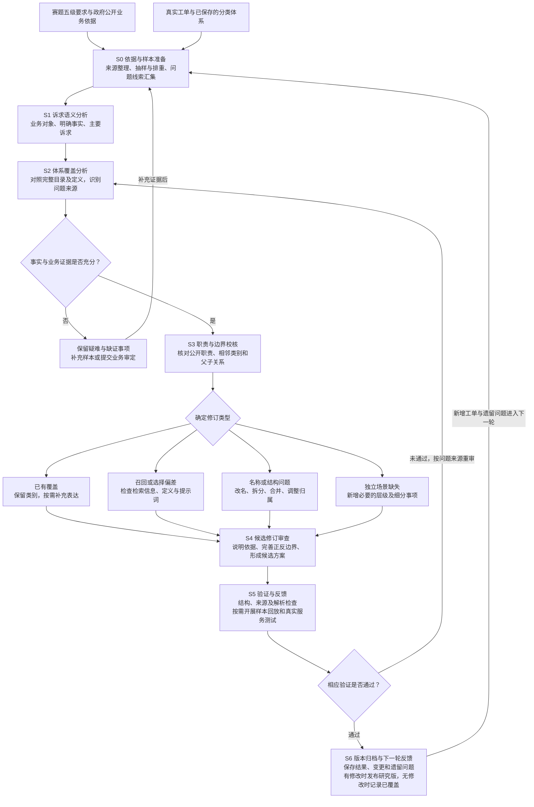

# 12345热线五级分类体系建设报告

[仓库首页](README.md) · [技术报告](分类体系构建依据与数据驱动优化报告.md) · [迭代流程图](分类体系构建与迭代流程图.md) · [参考来源](参考来源与引用说明.md)

**参赛题目：** 基于大模型的12345热线五级分类体系标准化与智能优化  
**项目名称：** 基于多模型协同与层级约束的12345热线五级分类体系构建及智能优化  
**编制日期：** 2026年10月29日  
**成果范围：** 五级分类标准体系的构建依据、数据应用、完善方法及阶段成果

## 摘要

12345热线工单既承载群众的具体诉求，也连接政府部门的业务职责。同一事项可能存在不同表达，同一段文字也可能包含多个问题。要实现稳定、可解释的智能分类，需要先明确业务对象、层级含义和类别边界，再将分类标准应用于模型推理。

本项目围绕赛题提出的“一级行业职能—二级处室职责—三级诉求事项—四级表现情形—五级细分事项”，结合北京市政府公开职责资料、接诉即办相关材料及多城市真实工单，逐步构建和完善五级分类体系，并以多阶段大模型辅助审校框架组织持续修订。建设过程中，先形成数据驱动的分类原型，再通过层级校正、职责溯源和真实样本审阅，持续处理类别混合、边界交叉、名称不准确及场景覆盖不足等问题。

截至报告编制日，最新研究版形成 **23个一级节点、236个二级节点、456个三级节点、634个四级节点和1396条完整五级路径**，其中868条为业务分类路径，1条为人工复核路径。项目同时形成类别定义、纳入与排除范围、典型示例，使分类目录不仅能够表达业务，也能够作为智能分类的约束依据。

本报告所述成果聚焦于数据驱动的分类标准建设与模型应用研究。体系通过对真实工单的深入挖掘与公开业务依据的严谨校准，构建了一套标准化且具备业务可解释性的智能分类体系。

## 一、目标与业务定位

本项目面向12345热线工单，建立统一的五级分类体系，将群众以自然语言描述的诉求，转化为层次清晰、含义一致、边界可解释的业务标签。五个层级依次表达行业职能、处室职责、诉求事项、表现情形和细分事项。

在热线场景中，仅依据关键词归类容易出现两类偏差。一类是不同事项被归入同一宽泛类别：工单都提到“职业技能证书”，实际诉求却可能分别是考试报名、证书补发或技能提升补贴申领。另一类是同一事项被拆成重复类别：“公积金提取后钱一直没到账”和“住房公积金提取款到账延迟”指向同一问题，不应因措辞不同而分别建立五级类别。分类体系既要区分不同的办理事项，也要统一同一事项的不同表述。

围绕这一目标，项目重点开展三方面建设：
1. **统一分类语义。**明确五个层级各自表达的内容，避免将行业、职责、事项和问题表现混在同一层。
2. **增强场景覆盖。**依据真实工单发现遗漏事项，覆盖高频民生问题，并纳入有明确业务意义的长尾诉求。
3. **建立持续完善机制。**结合新增工单，判断是否需要补充类别，同时复核现有类别的名称、定义和边界，使分类体系能够随业务变化持续维护。

通过上述建设，五级分类标签可用于辅助受理人员识别诉求、统一归类口径，并支持后续的诉求统计和体系维护。

## 二、构建依据与数据基础

### 2.1 依据赛题确定五级结构
赛题规定，五级分类依次对应行业职能、处室职责、诉求事项、表现情形和细分事项，同时提出了口语化表达、类别边界模糊、低频及新增诉求等难点。我们按各层级的含义命名类别，并逐条检查类别的上下级关系：上层归纳职责与事项，下层区分问题表现和具体诉求。使具体诉求能够沿着相应的职责和事项逐级归类。

### 2.2 以北京公开资料校准业务范围与职责

《北京市接诉即办工作条例》明确了诉求办理中的职责分工、派单原则和派单目录动态调整机制。项目据此将职责范围纳入分类设计，核对二级职责与其下诉求事项的对应关系。[《北京市接诉即办工作条例》](https://zwfwj.beijing.gov.cn/zwgk/2024zcwj/202405/t20240510_3670139.html)

在业务覆盖方面，项目对照《北京12345市民服务热线2025年度数据分析报告》列出的市场管理、劳动和社会保障、住房、公共服务、城乡建设等诉求领域，检查分类体系是否覆盖北京热线的主要民生事项。[《北京12345市民服务热线2025年度数据分析报告》](https://www.beijing.gov.cn/hudong/jpzt/2025ndsjbg/index.html)

在职责和类别命名方面，项目结合已收集的处室资料，查阅北京市政府部门公布的机构职责和办事指南：用机构职责核对管理范围，用办事指南区分具体办理事项。例如，[市市场监管局机构职权](https://scjgj.beijing.gov.cn/jgzq/)和[市人社局机构设置](https://rsj.beijing.gov.cn/xxgk/zfxxgk/jgxx/)为相关职责的梳理提供了依据。其他部门的公开资料入口见[参考来源与引用说明](参考来源与引用说明.md)。


### 2.3 结合北京与多城市真实诉求补充分类场景

项目以北京诉求为主要依据，结合其他城市的公开工单，查找现有分类尚未覆盖的事项。北京留言板和公开来信提供本地群众的实际表达；三亚、上海、福州数据则帮助发现低频诉求，以及同一事项在不同工单中的说法。

| 数据集 | 样本数量 | 主要用途 |
|---|---:|---|
| [北京公开诉求数据](https://www.beijing.gov.cn/hudong/hdjl/sindex/hdjl-xjxd.html) | 10000+条 | 梳理北京本地诉求、办理需求及类别边界 |
| [三亚12345工单数据](https://opendata.pku.edu.cn/dataset.xhtml?persistentId=doi:10.18170/DVN/XU3Q4W) | 180000+ 条 | 发现高频事项、低频场景和不同表述 |
| [上海12345公开数据](https://www.sh12345.gov.cn/#/demands) | 7000+ 条 | 补充城市管理和公共服务场景 |
| [福州12345公开数据](https://fz12345.fuzhou.gov.cn/#/fujianAppealPubilc?rigion=publish) | 700+ 条 | 补充办理事项及口语化表达 |

在使用这些数据时，项目先从工单中提取具体诉求，再判断现有类别能否准确表达该事项。跨城市数据用于发现可迁移的通用场景；类别名称和职责归属则结合北京工单与北京公开职责资料确定。例如，外地工单中的“社保卡遗失后补领”可以帮助识别这一办理事项，而分类名称仍按北京适用的业务表述核定。


## 三、五级体系的设计方法

### 3.1 明确各层级的业务作用

五级分类从职责范围逐步细化到工单的具体诉求。每一级回答不同的问题：

| 层级 | 表达的内容 |
| --- | --- |
| 一级行业职能 | 诉求所属的行业或公共服务领域 |
| 二级处室职责 | 该领域内与诉求相关的业务职责 |
| 三级诉求事项 | 群众诉求所指向的具体业务事项 |
| 四级表现情形 | 同一事项下具有共同特征的问题表现或办理状态 |
| 五级细分事项 | 能够依据工单事实区分的具体问题或办理需求 |

以小区充电设施诉求为例，当前体系设置了以下两条路径：

```text
住房城乡建设
└─ 物业管理职责
   └─ 共有设施管护
      └─ 充电设施配置与使用异常
         ├─ 充电设施不足或安装诉求
         └─ 充电设施管理不规范
```

两类工单都涉及小区充电设施，但反映的问题不同：车棚、充电桩或接口不足，要求增设设施的，归入“充电设施不足或安装诉求”；已有设施被占用、断电或使用管理混乱的，归入“充电设施管理不规范”。第四级概括充电设施的配置与使用问题，第五级进一步区分需要增设设施，还是需要改进现有设施的管理。

### 3.2 区分标准职责与具体机构

赛题要求二级分类体现处室职责。项目查阅北京市政府部门公开的机构设置、职责说明和业务单位资料，归纳形成“物业管理职责”“劳动关系管理职责”等二级名称，并在职责目录中记录对应机构及资料来源。

工单分类时，二级用于确定诉求涉及的业务职责；具体部门和处室信息则通过职责目录查询。机构职责发生调整后，依据新的公开资料更新对应关系，使分类体系保持一致的业务口径。

<!-- [taxonomy_v3.json]内的 duty_catalog 字段，有 1,396 条五级路径，各级节点数为 23 / 236 / 456 / 634 / 1,396。
目前有 236 条二级职责记录。每条包含一级行业、二级职责名称、对应路径数等信息；其中 139 条附有公开职责来源线索，97 条尚无来源记录。例如“物业管理职责”记录了北京市住建委物业管理处的来源页面。多数记录的核查状态仍是“逐项待核查”或“待核查”。
-->

### 3.3 以事实区分类别，以边界约束解释

每个类别除名称外，还记录定义、纳入和排除范围、典型示例及检索关键词。分类时，先看群众反映了什么问题、希望解决什么事项，再用类别边界核对归属。

例如，工单都提到“小区电梯”，实际诉求却可能不同：电梯故障停运，重点是设施维修；未经检验或存在安全隐患，重点是设备安全监管；电梯广告收益未公开，重点是小区公共收益管理。同一个对象可以涉及不同业务，分类依据是具体诉求，而不是“电梯”这个词。

遇到一张工单反映多个问题时，结合标题、正文和原有分类识别主要诉求；关键信息不足、无法确定类别时，进入人工复核。

## 四、多阶段大模型辅助审校与迭代闭环


### 4.1 总体框架

项目将分类体系的完善组织为七个环节：准备依据与样本、分析诉求语义、检查体系覆盖、核对职责与类别边界、审查修订方案、验证修订效果、归档版本并进入下一轮迭代。每一轮从真实工单中发现类别遗漏、名称不准或边界重叠等问题，结合公开业务资料形成修订方案。

修订后，选取涉及新增事项、易混类别和原有类别的真实工单进行验证：检查新类别能否覆盖相应诉求、相近类别能否区分，以及原有工单的归类是否受到影响。未通过的样本回查工单原文，调整后再次验证，并记录修改内容与验证结果。过程中，大模型辅助归纳诉求和发现问题，人工审阅核定类别调整，程序检查路径结构、重复类别和版本变化。下图展示这一迭代流程。

<!-- 关于样本验证
用真实工单检查修订后的类别能否覆盖诉求、相近类别能否区分，以及已有类别是否受到影响；这不等于已对全部工单做了有标准答案的准确率评测。
现有记录里的流程是：
1. 选样本。 从三亚、北京等真实数据中抽样，或围绕发现的问题定向找工单；记录数据来源和原始行号。样本包括拟新增类别的正例、容易误入该类别的反例，以及原有类别的回归样本。
2. 确定审校期望。 阅读工单原文，判断它实际要解决的事项，记录期望归入的类别。
3. 验证候选版本。 检查五级路径是否完整、重复，相关样本能否召回目标类别；对涉及边界的样本，比较修订前、首次验证和调整后的归类结果。
4. 处理失败样本。 回看原文和类别定义，修改名称、纳入排除范围或检索表达，再复验并保存结果。
 -->




### 4.2 分类体系迭代的七个环节

分类体系的修订从工单和业务资料出发。前四个阶段用于弄清诉求内容、现有类别能否覆盖以及应归属哪项职责；随后形成修订方案，用真实样本检验，最后保存版本和遗留问题。上一轮发现的疑难事项进入下一轮分析。

| 阶段 | 主要工作 | 阶段产出 |
|---|---|---|
| S0 依据与样本准备 | 整理公开业务资料和真实工单，抽取样本，汇集上一轮遗留问题 | 样本清单与待查问题 |
| S1 诉求语义分析 | 阅读工单原文，识别业务对象、问题事实和主要请求 | 诉求判断及存疑之处 |
| S2 体系覆盖分析 | 对照现有目录，判断是已有类别可以覆盖、类别选错，还是确有分类缺口 | 覆盖判断与问题线索 |
| S3 职责与边界校核 | 核对公开职责、相近类别及五级路径的父子关系 | 业务归属与类别边界 |
| S4 候选修订审查 | 确定保留、新增、拆分、合并或更名，并审查修订理由 | 候选方案与变更清单 |
| S5 验证与反馈 | 用新增事项、易混事项和历史类别的真实工单检验修订，并检查路径结构与重复情况 | 验证结果及需调整的问题 |
| S6 版本归档与下一轮反馈 | 保存样本依据、修改内容和验证结果，整理尚未解决的问题 | 分类体系版本与下一轮待办事项 |

各阶段的产出构成下一阶段的输入。例如，样本验证发现某条工单仍被归入相邻类别，就回查工单原文和类别边界，调整后再次验证；通过的修订再纳入版本记录。

### 4.3 从工单语义到修订决策

分析工单时，先确定群众反映的业务对象，再看具体发生了什么、希望解决什么。例如，同样提到“职业技能证书”，诉求可能是报名考试、补发证书，也可能是申领持证补贴。证书名称提供了业务线索，最终归类还要依据工单中的具体请求。

将诉求与现有目录对照后，分别处理不同问题：已有类别能够表达诉求，但检索时没有进入候选列表，就调整类别的检索信息；正确类别已进入候选列表却未被选中，就核查类别定义、边界和分类提示；现有类别确实无法表达该诉求，再考虑新增或调整分类路径。已经能够合理覆盖的场景，记录判断结果即可。

每项修订还需与相邻类别对照，明确各自适用的情形，并用相关工单复查。工单事实不足或涉及多个难以区分主次的诉求时，记录具体疑点，待补充样本或业务依据后继续审阅。

### 4.4 大模型辅助发现问题，结合业务依据审定修订

大模型用于批量阅读工单，初步识别现有类别的覆盖缺口、名称偏差和边界问题。审校人员再对照工单原文、完整分类目录及公开业务资料，判断哪些建议需要修改分类体系，并核对修改后的业务归属。

以一轮审校为例，项目从北京市委书记留言板、北京市市长留言板和三亚12345数据中分别抽取75条、75条和150条工单，共300条。模型初步标记了已覆盖、边界问题、可能缺口和信息不足等情况。经逐项复核，最终新增10条五级路径，修订7个已有类别；针对易混事项，还选取17条工单回放验证，发现误选后调整边界并再次验证。这一轮的修订由工单事实、分类目录和业务依据共同确定。

<!-- 业务依据：来源两类材料
真实工单原文：用于确认群众实际要办理或反映什么。每项变更对应的工单来源和行号记录在 [changes.json](/赛题四基于大模型的12345热线五级分类体系标准化与智能优化/datas/过程记录/taxonomy_v2_data_review_20261028/changes.json)。

公开职责资料：用于核对部分事项的职责归属。该轮 [sources.json](/赛题四基于大模型的12345热线五级分类体系标准化与智能优化/datas/过程记录/taxonomy_v2_data_review_20261028/sources.json) 记录了3项来源，包括北京市民政局社会事务管理处职责、儿童福利处职责，以及北京市契税相关办事资料。
 -->


### 4.5 验证与版本更新

修订方案形成后，使用相关真实工单检查新增类别是否覆盖对应诉求、相近类别是否能够区分，并复查原有类别的归类结果。每轮审校结束，记录样本来源、修改内容和验证结果，通过验证的修订纳入新版本。现有体系已能覆盖的诉求，保留审校记录，尚未解决的问题与下一批工单一起进入后续分析，使分类体系持续更新。

完整步骤见[分类体系构建与迭代流程图](分类体系构建与迭代流程图.md)，具体案例和验证记录见[技术报告](分类体系构建依据与数据驱动优化报告.md)。


## 五、代表性完善案例

### 5.1 区分会计继续教育、考试报名与证书领取

真实工单中，群众可能将会计继续教育、资格考试报名和证书领取统称为“会计证问题”。分类体系依据工单中的具体请求，将这三类办理事项分别表达。

项目参考[北京市财政局会计处职责](https://czj.beijing.gov.cn/zwxx/jgjj/nsjg/201912/t20191209_974896.html)、[会计继续教育通知](https://czj.beijing.gov.cn/zwxx/tztg/202604/t20260407_4574966.html)和[会计资格考试报名通知](https://czj.beijing.gov.cn/zwxx/tztg/202512/t20251225_4362451.html)，将继续教育和考试报名归入财政会计职责。对于考试合格后的证书领取与邮寄，参考[会计初级资格证书发放通知](https://rsj.beijing.gov.cn/ywsite/bjpta/kszl/zscx/202609/t20260920_4871766.html)，归入人事考试服务职责。现有分类体系对应以下路径：

| 工单诉求 | 五级分类路径 |
|---|---|
| 咨询继续教育课程或学分政策 | 财政管理 → 会计管理职责 → 会计人员服务 → 继续教育参与及学分认定咨询 → 会计人员继续教育课程及学分政策咨询 |
| 咨询会计资格考试报名条件、所需材料 | 财政管理 → 会计管理职责 → 会计人员服务 → 专业技术资格考试报名需求 → 会计专业技术资格考试报名条件材料咨询 |
| 咨询考试合格证书的领取或邮寄 | 人力资源社会保障 → 人事考试服务职责 → 专业技术资格证书服务 → 考试合格证书申领与寄送问题 → 会计专业技术资格证书领取及邮寄咨询 |

这组分类保留了共同的“会计”业务背景，同时根据群众实际要办理的事项，区分学习、报考和领证。

### 5.2 区分社保卡办理与医保待遇

在真实工单中，“社保卡”既可能指卡片本身，也可能只是群众描述医保报销问题时提到的凭证。分类体系因此结合具体请求，区分办卡、补卡、查询制卡进度和咨询医保待遇。

针对卡片办理，项目从工单中梳理出三类诉求，并参考[北京市社会保障卡常态化换发通知](https://rsj.beijing.gov.cn/xxgk/tzgg/202601/t20260104_4395898_ext.html)核对业务划分。现有分类体系设置了以下路径：

| 工单诉求 | 五级分类路径 |
|---|---|
| 咨询首次申领的材料或渠道 | 人力资源社会保障 → 社会保障卡服务职责 → 社会保障卡办理 → 卡片申领条件与办理流程 → 社会保障卡申领材料及渠道咨询 |
| 卡片遗失后咨询挂失、补领 | 人力资源社会保障 → 社会保障卡服务职责 → 社会保障卡办理 → 卡片遗失后的挂失补领需求 → 社会保障卡遗失挂失及补领咨询 |
| 已申请办卡，查询制卡进度或反映长时间未收到卡 | 人力资源社会保障 → 社会保障卡服务职责 → 社会保障卡办理 → 制卡发卡进度及等待异常 → 社会保障卡制发进度查询及久未领卡诉求 |

对于“没有社保卡能否报销”一类工单，重点是医保待遇和结算规则，应根据实际请求核对医保类别。这样，同样提到社保卡的工单，也能按**卡片办理**或**咨询医保**分别归类。


### 5.3 区分孕产健康教育与辅助生殖服务

北京公开来信中，有市民询问线上孕妇课程的参与方式，也有市民咨询自身情况是否符合试管婴儿服务条件。两类诉求都涉及妇幼健康，但前者关注健康教育，后者关注辅助生殖服务。

项目结合工单原文，以及[北京线上孕妇学校资料](https://wjw.beijing.gov.cn/xwzx_20031/jcdt/202002/t20200217_1647160.html)和[辅助生殖技术质量管理资料](https://wjw.beijing.gov.cn/xwzx_20031/jcdt/202510/t20251023_4236581.html)，将原先混在同一类别中的两类咨询分别表达。现有分类体系对应以下路径：

| 工单诉求 | 五级分类路径 |
|---|---|
| 咨询孕妇学校、线上课程及参与渠道 | 卫生健康管理 → 妇幼健康管理职责 → 孕产与生殖健康服务 → 孕产健康教育课程参与需求 → 孕妇学校及孕产健康教育课程咨询 |
| 咨询辅助生殖或试管婴儿服务条件 | 卫生健康管理 → 妇幼健康管理职责 → 孕产与生殖健康服务 → 辅助生殖服务适用条件咨询 → 辅助生殖及试管婴儿服务条件咨询 |

两条路径保留了共同的妇幼健康业务范围，并在第四、五级区分课程参与和医疗服务条件，使工单按实际咨询事项归类。


### 5.4 区分待遇申领、发放查询与资格争议

残疾人补贴和失业保险工单都可能提到“待遇”，但群众当前要解决的问题并不相同：有的咨询如何申请，有的查询款项发放情况，有的对拒绝受理或停发提出异议。项目结合真实工单，并参考[失业保险金申领办事指南](https://rsj.beijing.gov.cn/xxgk/tzgg/202511/P020251113371715711163.pdf)和[北京市残疾人两项补贴认定办事资料](https://banshi.beijing.gov.cn/pubtask/task/1/110108002000/ccbd44aa-53b0-4fca-9f8c-2c759ab755b4.html?locationCode=110108002000&serverType=1003)，按具体办理事项设置类别。

| 工单诉求 | 五级分类路径 |
|---|---|
| 咨询失业保险金申领条件和办理方式 | 人力资源社会保障 → 失业保险管理职责 → 失业保险待遇 → 失业金申领条件材料与渠道 → 失业保险金申领条件及办理咨询 |
| 对失业保险金拒绝受理或资格审核结果提出异议 | 人力资源社会保障 → 失业保险管理职责 → 失业保险待遇 → 失业金受理与资格审核争议 → 失业保险金拒绝受理及资格审核争议 |
| 查询残疾人补贴发放时间或反映未到账 | 民政与残疾人服务 → 残疾人福利补贴管理职责 → 残疾人福利补贴 → 补贴发放状态与资格复核问题 → 残疾人补贴发放时间及未到账查询 |
| 对残疾人补贴停发或资格复核结果提出异议 | 民政与残疾人服务 → 残疾人福利补贴管理职责 → 残疾人福利补贴 → 补贴发放状态与资格复核问题 → 残疾人补贴停发及资格复核争议 |

工单还可能出现“为了申请失业保险金，单位一直不开离职证明”的情况。此时群众当前请求解决的是证明开具问题，分类体系将其归入“人力资源社会保障 → 劳动关系管理职责 → 劳动权益维护 → 离职手续及证明开具问题 → 解除终止劳动合同证明拒开或拖延”。这一归类也与[北京市关于解除、终止劳动合同证明的公开答复](https://www.beijing.gov.cn/hudong/bmwd/jsjbmyyt/2022jmwd/shbz2022/xjyxtldbz2022/202210/t20221027_2846217.html)所述业务问题相对应。


## 六、阶段成果与应用价值

### 6.1 分类规模与覆盖领域

截至2026年11月18日，分类体系 v3 包含以下类别。各级节点按完整父路径统计；同名类别位于不同父节点下时分别计数。

| 层级 | 节点数量 |
|---|---:|
| 一级行业职能 | 23 |
| 二级处室职责 | 236 |
| 三级诉求事项 | 456 |
| 四级表现情形 | 634 |
| 五级细分事项及完整路径 | 1,396 |

分类体系覆盖住房城乡建设、城市管理、交通运输、市场监管、人力资源社会保障、卫生健康、医疗保障、教育、民政、生态环境、农业农村、财税、综合受理等领域。其中，“综合受理”用于难以归类诉求的人工复核。五级路径为工单归类、相近诉求区分和分类统计提供了统一目录。

### 6.2 形成可解释、可维护的分类知识

五级分类体系不仅记录类别名称，还为类别配置业务定义、检索关键词、纳入与排除范围，以及正反例。这些信息帮助审阅人员理解类别含义，区分相近诉求，也为后续调整提供依据。真实工单证据和历次修改记录保存在过程档案中，可按类别回查。

最新 v3 版本形成 236 个“行业职能—二级职责”分组。项目已为 139 个分组关联公开资料，记录 130 个不同的来源网址，将分类路径、职责资料和修订记录联系起来，支持分类体系的持续核查与更新。

### 6.3 支持智能分类与持续更新

分类体系以机器可读目录保存。规则检索和向量检索从中筛选相关类别，大模型结合工单内容、原三级标签和类别定义选择五级路径，程序校验结果是否属于目录。类别名称、定义或适用边界发生调整后，可以更新目录，并用相关真实工单验证修订效果。

统一的五级路径可用于同类诉求归集、细分事项统计和分类结果解释，也为后续结合属地与权责规则开展工单办理提供分类依据。

## 七、验证情况与后续工作

### 7.1 分类体系与系统流程验证

项目从分类目录的结构、真实工单的候选召回和完整分类流程三个方面开展验证，分别检查分类标准能否被系统读取、目标类别能否进入候选范围，以及工单能否形成有效的五级分类结果。

| 验证内容 | 验证范围 | 结果 |
|---|---|---|
| 最新分类目录核验 | v3 分类体系 | 对 1,396 条五级路径进行检查，五个层级均完整；类别 ID、完整路径和五级类别名称均未发现重复 |
| 候选召回验证 | v3 迭代阶段的 100 条真实工单 | 经类别和检索信息修订后，目标类别均进入规则召回前 20 条候选 |
| 系统全流程验证 | 使用 v3.9 分类目录快照，分 10 批处理 1,000 条真实工单 | 全部工单均输出目录内的完整五级路径；998 条采用模型结果，2 条采用召回结果回退 |

上述结果分别对应最新版目录核验和开发过程中的召回、流程验证。它们说明分类体系具备供系统使用的结构基础，真实工单能够进入分类流程以及整个流程可以稳定运行。

### 7.2 下一阶段的验证与完善

下一阶段将以 v3 分类体系为基础，与业务人员共同核对职责归属和相近类别的边界，并为样本较少的类别补充真实工单。项目还将建立与迭代样本分开的评测集，重点检验四、五级分类结果、易混事项的区分能力、新诉求的归类效果和推理效率。

根据评测结果，先调整已有类别的名称、定义和检索信息；确认现有目录无法表达的业务事项，再补充分类路径。每项新增或调整都保留对应工单、业务依据和验证记录，作为后续版本更新的依据。

## 附录：资料与案例说明

**赛题依据。** 项目依据《赛题四》说明材料确定五级分类结构和智能分类目标。

**业务资料。** 报告引用北京市接诉即办制度、12345年度数据分析报告、政府机构职责和办事资料，用于核对业务范围与职责划分。五级分类目录由项目结合这些资料和真实工单构建。

**案例来源。** 报告中的工单案例根据真实诉求概括表述，便于说明类别形成及边界判断；


## 参考文献与来源

本报告引用的数据平台、北京市政府机构职责及办事资料列于下文。数据来源对应真实工单样本，机构职责和办事资料用于核对业务归属与类别边界；分类体系的修改及验证结果可在项目过程记录中查阅。本节资料链接于2026年11月19日核对。

### 参考资料一 真实数据来源

这些链接说明样本来源及查询入口，不证明所有工单均有五级标注，也不证明项目分类结果得到平台认定。

| 数据集 | 来源及入口 | 对应本地数据 |
|---|---|---|
| 北京公开诉求数据 | [人民网领导留言板](https://liuyan.people.com.cn/),[北京市人民政府公开信件](https://www.beijing.gov.cn/hudong/hdjl/sindex/hdjl-xjxd.html) | [北京市领导留言板_各区书记区长_建言投诉求助咨询.xlsx](datas/data1/北京市领导留言板_各区书记区长_建言投诉求助咨询.xlsx) |
| 三亚12345工单数据 | [北京大学开放研究数据平台](https://opendata.pku.edu.cn/dataset.xhtml?persistentId=doi:10.18170/DVN/XU3Q4W) | [sanya12345_dataset.csv](datas/data2/sanya12345_dataset.csv) |
| 上海12345公开数据 | [上海12345诉求公开](https://www.sh12345.gov.cn/#/demands) | [shanghai_12345_public.csv](datas/data2/shanghai_12345_public.csv) |
| 福州12345公开数据 | [福州12345诉求公开](https://fz12345.fuzhou.gov.cn/#/fujianAppealPubilc?rigion=publish) | [fuzhou_12345_public_350100.csv](datas/data2/fuzhou_12345_public_350100.csv) |


### 参考资料二 政府机构与职责资料

以下22项根据《各部门的真实处室的来源》整理。


| 部门或材料         | 原始公开入口                                                                                             |
| ------------- | -------------------------------------------------------------------------------------------------- |
| 北京市交通委员会      | [公开资料](https://jtw.beijing.gov.cn/xxgk/jgzn/jgsz/)                                                 |
| 北京市市场监督管理局    | [公开资料](https://scjgj.beijing.gov.cn/jgzq/)                                                         |
| 北京市卫生健康委员会    | [公开资料](https://wjw.beijing.gov.cn/wjwh/ztzl/zqgs_1/nsjg/)                                          |
| 北京市人力资源和社会保障局 | [公开资料](https://rsj.beijing.gov.cn/xxgk/zfxxgk/jgxx/)                                               |
| 北京市民政局        | [公开资料](https://mzj.beijing.gov.cn/col/col243/index.html)                                           |
| 北京市公安局        | [公开资料](https://gaj.beijing.gov.cn/zfxxgk/jgzn/202001/t20200102_1554557.html)                       |
| 北京市规划和自然资源委员会 | [公开资料](https://ghzrzyw.beijing.gov.cn/zhengwuxinxi/jggk/nsjg/)                                     |
| 北京市教育委员会      | [公开资料](https://jw.beijing.gov.cn/xxgk/zfxxgkml/zwgkjgzn/zwgknsjg/)                                 |
| 北京市城市管理委员会    | [公开资料](https://csglw.beijing.gov.cn/zwxx/jgzn/zqxx/bjsszsrglwyh/nsjg/)                             |
| 北京市生态环境局      | [公开资料](https://sthjj.beijing.gov.cn/bjhrb/index/xxgk69/zfxxgk43/fdzdgknr2/zqxx84/nsjg/index.html)  |
| 北京市农业农村局      | [公开资料](https://nyncj.beijing.gov.cn/nyj/zwgk/jgzn/jgsz/index.html)                                 |
| 北京市文化和旅游局     | [公开资料](https://whlyj.beijing.gov.cn/zfxxgkpt/zdgk/jgzn/nsjg/)                                      |
| 北京市体育局        | [公开资料](https://tyj.beijing.gov.cn/bjsports/jgzz17/458329/index.html)                               |
| 北京市应急管理局      | [公开资料](https://yjglj.beijing.gov.cn/col/col2492/index.html)                                        |
| 北京市政务服务和数据管理局 | [公开资料](https://zwfwj.beijing.gov.cn/zwgk/qzxx/jgsz/)                                               |
| 北京市园林绿化局      | [公开资料](https://yllhj.beijing.gov.cn/zwgk/jgzn/nsjg/)                                               |
| 北京市医疗保障局      | [公开资料](https://ybj.beijing.gov.cn/zwgk/2020_zfxxgk/2020_jgjj/)                                     |
| 北京市水务局        | [公开资料](https://swj.beijing.gov.cn/zwgk/jgxx/nsjg/)                                                 |
| 国家税务总局北京市税务局  | [公开资料](http://beijing.chinatax.gov.cn/bjswj/c105838/202104/3a05462b142b472895c75c3e78392d0f.shtml) |
| 原北京市地方金融监督管理局 | [公开资料](https://www.beijing.gov.cn/gongkai/caizheng/czzt/2022js/202308/t20230825_3230579.html)      |
| 北京市退役军人事务局    | [公开资料](https://tyjrswj.beijing.gov.cn/zwgk/nsjg/)                                                  |
| 北京市商务局        | [公开资料](https://sw.beijing.gov.cn/zt/zqxx/nsjg/)                                                    |


机构名称并不都对应内设处室。部门、处室、直属机构和业务单位分别记录。

### 参考资料三 制度与具体业务依据


| 资料                                                                                              | 支持的论述               |
| ----------------------------------------------------------------------------------------------- | ------------------- |
| [北京市接诉即办工作条例](https://zwfwj.beijing.gov.cn/zwgk/2024zcwj/202405/t20240510_3670139.html)         | 职责导向、派单目录及动态维护的制度背景 |
| [北京12345年度数据分析报告](https://www.beijing.gov.cn/hudong/jpzt/2025ndsjbg/index.html)                 | 重要民生领域及业务名称参照       |
| [北京市财政局会计处职责](https://czj.beijing.gov.cn/zwxx/jgjj/nsjg/201912/t20191209_974896.html)           | 会计人才及资格管理的职责线索      |
| [2026年会计人员继续教育通知](https://czj.beijing.gov.cn/zwxx/tztg/202604/t20260407_4574966.html)           | 课程、学分及审核事项的区分       |
| [会计资格考试报名通知](https://czj.beijing.gov.cn/zwxx/tztg/202512/t20251225_4362451.html)                | 考试报名与继续教育、领证分开表达    |
| [会计初级资格证书发放通知](https://rsj.beijing.gov.cn/ywsite/bjpta/kszl/zscx/202609/t20260920_4871766.html) | 人事考评办公室的发证服务依据      |
| [社会保障卡常态化换发通知](https://rsj.beijing.gov.cn/xxgk/tzgg/202601/t20260104_4395898_ext.html)          | 申领、补换及制卡进度业务区分      |
| [异地就医网上备案流程](https://ybj.beijing.gov.cn/2020_zwfw/2020_cjwt/202107/t20210713_2434753.html)      | 备案申请与报销结算分开表达       |
| [北京线上孕妇学校资料](https://wjw.beijing.gov.cn/xwzx_20031/jcdt/202002/t20200217_1647160.html)          | 孕产健康教育课程是独立服务事项     |
| [辅助生殖技术质量管理资料](https://wjw.beijing.gov.cn/xwzx_20031/jcdt/202510/t20251023_4236581.html)        | 辅助生殖具有独立技术服务范围      |


具体业务资料与正文案例相互对应；引用资料并不代表本项目类别已经获得相关部门认定，逐类职责归属仍按业务范围审定。
