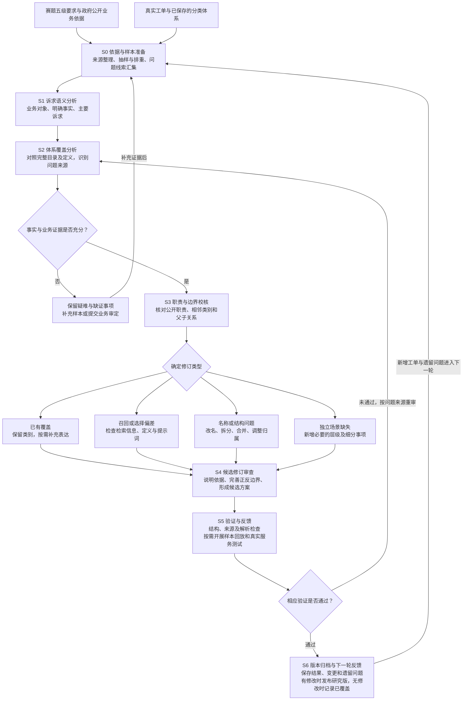

# 分类体系构建与迭代流程图

[仓库首页](README.md) · [建设报告](12345热线五级分类体系建设报告.md) · [技术报告](分类体系构建依据与数据驱动优化报告.md) · [参考来源](参考来源与引用说明.md)

统一方法名称：**多阶段大模型辅助审校框架**。统计日期：2026年10月29日；对应研究版为 `v5-20261029-accounts-health`，共869条五级路径。

本图将实际开展的数据分析、模型辅助、语义审阅和程序验证归纳为七个阶段。各分析阶段可以复用同一模型，也可以扩展为不同模型协同。

## 阶段含义与闭环产出

| 阶段 | 主要产出 | 下一阶段如何使用 |
|---|---|---|
| S0 依据与样本准备 | 来源、样本、排重口径及待查问题 | 为语义判断提供真实文本和背景 |
| S1 诉求语义分析 | 业务对象、主要诉求、关键事实与歧义 | 区分文本主题和真正需要解决的问题 |
| S2 体系覆盖分析 | 已覆盖、选择偏差、定义结构问题、缺类或缺证线索 | 决定需要核查的职责与相邻类别 |
| S3 职责与边界校核 | 归属依据、易混边界及待审定项 | 约束新增或调整方案 |
| S4 候选修订审查 | 保留或修改决定、候选分类及迁移说明 | 明确验证对象，避免只扩数量 |
| S5 验证与反馈 | 检查结果、回归结果及未通过原因 | 通过则归档，未通过则定位并重审 |
| S6 版本归档与下一轮反馈 | 版本、证据、遗留问题及下轮样本方向 | 让新工单和未解决问题持续进入闭环 |

## 对应材料

- [赛事评审报告](12345热线五级分类体系建设报告.md)：说明方法依据、业务价值和阶段成果。
- [技术报告](分类体系构建依据与数据驱动优化报告.md)：说明各阶段如何开展、证据在哪里、验证到哪一步。

统计口径：按完整父路径计数，一级23、二级237、三级387、四级492、五级869；包含868条业务路径及1条人工复核路径。
