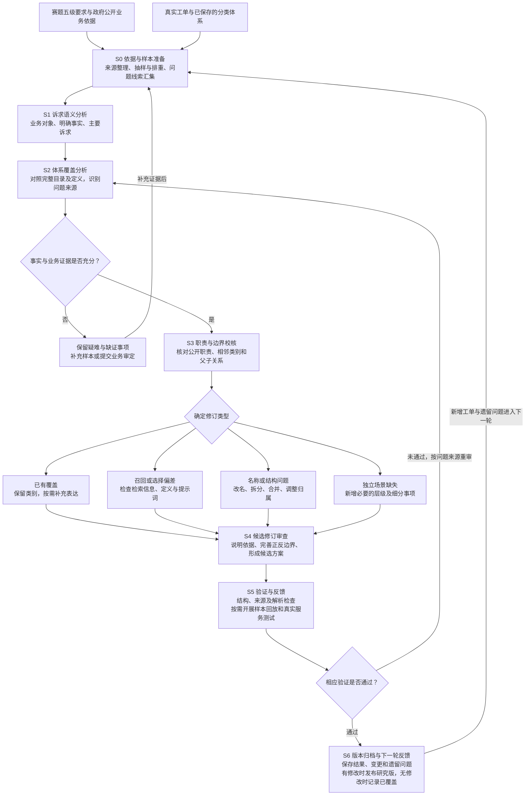

# 12345热线五级分类体系构建依据与数据驱动优化报告

[仓库首页](README.md) · [建设报告](12345热线五级分类体系建设报告.md) · [迭代流程图](分类体系构建与迭代流程图.md) · [参考来源](参考来源与引用说明.md)

编制日期：2026年10月28日；修订日期：2026年10月29日  
项目：基于多模型协同与层级约束的12345热线五级分类体系构建及智能优化  
对象：分类标准的形成、修订和验证过程；不涉及本次重新部署或切换线上体系。

## 一、成果概述

本项目围绕赛题四提出的“一级行业职能—二级处室职责—三级诉求事项—四级表现情形—五级细分事项”，构建可供模型选择、可追溯和可持续维护的分类标准。体系的形成结合了三类依据：赛题规定的层级语义，北京市接诉即办及政府单位公开职责资料，以及北京、三亚、上海、福州等地的真实诉求文本。

工作经历了数据驱动原型、层级与边界校正、真实样本反复审校、政府职责溯源强化等阶段。主要解决真实工单如何归类的问题；四五级区分不足、同义类别重叠等问题，再通过修改逐步纠正。经过团队内部讨论后，进一步将标准职责与机构证据分离，形成目前的 v2 草案。

截至本报告核验时，最新研究草案含 **23个一级节点、237个二级节点、387个三级节点、492个四级节点和869条完整五级路径**，其中1条是人工复核兜底。

训练分类体系，是**基于真实工单的分类体系构建、数据驱动校准和大模型辅助审校**。现有可核验材料体现了模型API调用、提示词调整、检索辅助和人工语义复核，未体现通过这些工单对基础模型进行参数微调。因此，本报告使用“构建、校准、审校、迭代”等表述，不将其写成监督微调或从零训练模型。

本报告依据项目现存版本、样本清单、逐单结果、修改记录和官方资料编制。本文的方法归纳用于解释各阶段工作之间的联系，不将后来补充的依据倒写成第一版已具备的依据。当前数量重新计算，历史实验按当时版本和记录说明。2026年10月29日核验统计与文件指纹

## 二、标准来自哪里，各类依据分别解决什么问题

### 2.1 赛题材料确定五级结构和应用目标

本地保存的赛题四技术答疑整理指出：原有三级体系难以充分表达职责和细粒度诉求，需要建立五级分类标准，并面向口语化文本、边界模糊、长尾样本和新增诉求开发智能分类能力。

据此，项目首先确定五级结构的含义，随后围绕每个层级的作用修改名称和父子关系。该文件属于技术答疑整理，能够说明项目的任务理解；它不等同于完整的最终评分细则，也不能据此推断主办方已提供全部五级标签。

### 2.2 接诉即办制度提供职责导向和动态维护依据

[《北京市接诉即办工作条例》](https://zwfwj.beijing.gov.cn/zwgk/2024zcwj/202405/t20240510_3670139.html)第十一、十二条涉及按职责及派单目录处理诉求、动态调整目录、对职责或管辖存在异议的事项开展协调。这为项目采用职责导向和持续更新的分类设计提供制度背景。

项目据此将“职责依据”“具体诉求分类”“实际承办关系”分别处理。分类结果可以辅助识别办理范围，但不能直接替代正式派单目录或认定某个市级处室是唯一承办单位。项目自行构建的目录也不表述为北京市官方公布的完整五级目录。

### 2.3 官方统计用于检查业务范围和名称

[北京12345市民服务热线2025年度数据分析报告](https://www.beijing.gov.cn/hudong/jpzt/2025ndsjbg/index.html)列出了市场管理、劳动和社会保障、住房、公共服务、城乡建设、农村管理等诉求领域及下属主题。项目利用这类资料检查是否遗漏重要业务领域，并参考公共业务名称。

官方统计用于提供覆盖方向，不能直接转换为完整五级树，也不意味着本项目必须采用相同类别数量。项目的叶子类别仍需由实际工单和业务边界支持。

### 2.4 政府机构资料校正二级职责

同事提供的部门来源索引和部门处室及来源整理，用于建立检索清单。后续结合北京政府网站的机构职能、内设机构、事业单位职责和办事指南，核查具体业务范围。

这些资料的证据能力不同：机构名单能帮助定位单位；现行职责页面能支持职责范围；办事指南能支持具体办理事项；历史文件只能说明相应时期的业务情况。项目不把旧年度名录直接当作全部现行权责清单，也不因文件列出一个处室就推断所有相关诉求均由其办理。

### 2.5 内部讨论推动结构修订

《26.10.27五级分类讨论》指出，早期部分二级标签缺少真实机构职责依据，需要从公开部门、处室及相关单位职责中提炼标准职责，并考虑行业与职责的相对独立性。

该材料是项目内部设计讨论，不作为官方新增要求。项目据此建立职责证据目录，保留合理的后三层业务分类，并逐步核查和修改二级名称，而不是仅在原标签后加上“职责”二字。

## 三、真实数据的组成与实际用途

### 3.1 当前原始数据盘点

以下为2026年10月28日重新读取文件得到的非空数据行数。CSV与JSONL同源格式只列一次，明显重复副本不重复计入。Excel按实际非空数据行统计，不以文件名推断数量。

| 数据文件 | 数据行数 | 在体系构建中的作用 |
|---|---:|---|
| sanya12345_dataset.csv | 184,568 | 大规模场景发现、主题扫描、长尾诉求和边界案例挖掘 |
| 北京市委书记留言板.xlsx | 3,204 | 北京本地诉求场景、正文语义和跨部门问题补充 |
| 北京市市长留言板.xlsx | 1,191 | 北京本地事项校准，与书记留言板共同参与抽样和主题分析 |
| 北京领导留言板_样本.xlsx | 2,585 | 北京场景补充及历史审校，需注意与其他北京文件的内容重叠 |
| beijing_12345_public_letters.csv | 212 | 政策咨询、办理流程、资格、证明等公开来信场景 |
| fuzhou_12345_public_350100.csv | 701 | 跨城市场景补充，检查类别是否过度局限于某地措辞 |
| shanghai_12345_public.csv | 7,248 | 跨城市诉求和业务边界补充 |
| 脱敏_五级分类数据-1万条-补充五级.xlsx | 0 | 当前仅有表头，不能作为已获得1万条标注样本的证据 |
| **上述单一格式文件合计** | **199,709** | **为行数合计，尚未按跨文件同一诉求全面去重** |

原始文件及其哈希、字段和计数保存在核验统计，原文件位于原始数据集目录。三亚数据按GB18030读取，其余公开CSV按UTF-8读取。

三亚文件中，非空工单编号去重为 **184,560个**；仅删除正文空白后按正文哈希去重为 **162,241份文本**。两种口径不同：同文续单、相近改写和不同编号可以重复出现。因此，“18万余行”不能写成“18万条互不重复、全部人工标注过的独立工单”。旧说明中“约9万”的表述缺少本次可复现口径，本报告不沿用。

北京公开来信还存在一份长哈希文件名的同内容CSV副本，以及同源JSONL及其副本。不能将这些副本算作不同来源。同样，书记、市长和领导留言板样本之间可能重叠，表中的合计不是去重后的独立事件总数。

### 3.1.1 数据来源与文件对应核查

- [北京书记留言板](https://liuyan.people.com.cn/threads/list?fid=539)：对应 `北京市委书记留言板.xlsx`；动态页面，文本检索未取得列表正文。
- [北京市长留言板](https://liuyan.people.com.cn/threads/list?fid=540)：对应 `北京市市长留言板.xlsx`；动态页面，文本检索未取得列表正文。
- [三亚12345研究数据](https://opendata.pku.edu.cn/dataset.xhtml?persistentId=doi:10.18170/DVN/XU3Q4W)：对应 `sanya12345_dataset.csv`；已核对数据集说明及文件MD5。
- [上海12345诉求公开](https://www.sh12345.gov.cn/#/demands)：对应 `shanghai_12345_public.csv`；动态页面，文本检索未取得列表正文。
- [福州12345诉求公开](https://fz12345.fuzhou.gov.cn/#/fujianAppealPubilc?rigion=publish)：对应 `fuzhou_12345_public_350100.csv`；本次抓取超时；本地记录保留原条目URL。
- [北京首都之窗公开信件](https://www.beijing.gov.cn/hudong/hdjl/sindex/hdjl-xjxd.html)：对应 `beijing_12345_public_letters.csv`；已取得信件列表正文。

三亚本地CSV的MD5为 `a5b20a6c86d72a5db66729b91fbcab72`，与北京大学开放研究数据平台公布值相同。该平台元数据说明2018年10月至2019年2月的历史记录；因此不能将样本中的历史条件直接转成北京现行政策。文件一致性不等于完成去重、五级标注或事实审核。

动态网站未取得正文不等于链接失效，也不能写成已重新下载验证。北京公开来信、福州文件的source_url可继续定位原条目；上海文件的来源多为公开列表入口，追溯粒度相对有限。北京领导留言板样本与书记、市长文件的逐条对应关系仍需核验。

### 3.2 数据不是只拿来统计，也参与了具体修改

北京书记、市长留言板实际参与过体系优化。例如2026年10月28日的300条分来源审校中，两份文件各抽取75条；契税、婚姻登记、轨道交通提示和垃圾点位等专项还使用正文检索补充证据。因此，这两份数据并非只作为参考附件存放。本轮审校记录

三亚数据量较大，承担了广泛发现问题的任务。对于北京体系，迁移的是“群众遇到什么业务问题”的场景，不直接迁移三亚部门名称、历史补贴金额、旧政策资格或地方办理规定。例如技能补贴诉求可以支持细分场景，但二级职责仍需结合北京公开资料核查。

上海、福州及北京公开来信参与历史多城市抽样，用于寻找政策咨询、手续办理、收费、公共设施等范围中的缺口。公开留言板和热线工单的文本形态、受理范围存在差别，不能将多城市数据的分布当作北京热线真实业务占比。

### 3.3 “收集、扫描、审阅、测试”分别计数

项目中不同工作具有不同覆盖范围：

| 工作 | 实际含义 | 可核验例子 |
|---|---|---|
| 收集与盘点 | 文件已保存并能读取 | 本次原始文件计数 |
| 全量关键词扫描 | 程序遍历文件，筛出相关记录 | 第8轮三亚扫描得到64条命中 |
| 定向语义审阅 | 阅读命中正文，判断是否构成独立诉求 | 第9轮137条命中中重点审阅13条医疗、保安相关记录 |
| 大模型辅助审校 | 将选定工单与候选类别提交API分析 | 300条、6批、每批50条的GLM-4.6审校 |
| 全链路验证 | 调用召回与分类流程，保留逐单结果 | 历史10批各100条、共1000条的真实服务验证 |
| 回归测试 | 对参与设计或修订的重点样本复验 | 17条婚姻、收养、税务等边界回放 |

全量扫描不等于逐条人工深读，模型审校不等于人工金标准标注，回归样本也不能再次作为未见过的独立测试集。

历史记录采用过多种抽样和哈希方案，且目录有迁移。当前可以核验若干批次，但尚不能可靠给出“历次所有工作累计使用了多少互不重复工单”的统一总数，因此不将各轮样本数直接相加。2026年10月27日记录中扫描52份清单得到36,288个历史哈希，这只是该轮排重范围，不能解释为36,288条已完成专家标注的样本。

## 四、五级结构如何从数据中形成

体系采用自上而下确定语义、自下而上提炼事项的方式。赛题定义约束层级，政府职责资料约束业务范围，真实工单补充具体事项和表现情形。

| 层级 | 主要回答的问题 | 设计要求 |
|---|---|---|
| 一级：行业职能 | 属于哪个行业或公共服务领域？ | 稳定、范围适当，避免同义行业重复 |
| 二级：处室职责 | 对应哪类有公开依据的公共职责？ | 使用标准职责名称，并关联实际机构依据 |
| 三级：诉求事项 | 群众要办理、解决或反映什么业务？ | 保留稳定业务对象，不混入不相干事项 |
| 四级：表现情形 | 该事项发生了哪类问题或办理情形？ | 按具体业务组织，避免全部套用“咨询、投诉、建议” |
| 五级：细分事项 | 在该情形下，需要区分哪一种具体诉求？ | 边界明确，能够依据工单事实选择 |

例如，最新草案中的两条路径共享前四级：

```text
民政与残疾人服务
  → 婚姻登记管理职责
  → 婚姻登记事项
  → 婚姻证件补领与登记档案问题
      → 婚姻登记证件遗失补领咨询
      → 婚姻登记档案核验及信息不一致
```

第四级概括共同的办理情形，第五级区分“遗失补领”和“档案信息问题”。它们不是把同一句话重复写两遍。

三级、四级只有一个子节点时，项目检查其是否为重复命名、父节点过窄或相邻事项可以共用父节点。能够证明同属稳定业务的，迁移到共同父节点；业务不同的，保留。单支比例是审阅线索，不是合并阈值，不能为了让树形好看而把不同职责或事项强行归在一起。

最新版本仍存在单支节点，具体数量见第九节。体系保持五级语义完整，同时继续用真实样本判断是否需要细分或重组。

## 五、一次分类体系迭代实际怎样完成

### 5.0 统一阶段与实施边界

本文与赛事报告、独立流程图共用**多阶段大模型辅助审校框架**及S0—S6编号。它是对已有工作和扩展设计的统一组织，不表示已部署七个独立模型服务。当前阶段性操作由程序、模型辅助和语义审阅共同承担；语义审阅不自动等同于业务专家正式审定。



| 阶段 | 输入与输出约定 | 当前实施及可追溯证据 |
|---|---|---|
| S0 依据与样本准备 | 原始数据、资料、历史清单 → 样本及来源 | 已有抽样、主题扫描、正文哈希；第13轮 sampling_manifest 与样本文件 |
| S1 诉求语义分析 | 工单正文 → 对象、事实、主诉求及歧义 | 历史300条模型审校；第13轮语义正反例及歧义记录 |
| S2 体系覆盖分析 | 诉求与完整目录 → 覆盖或问题判断 | 模型初筛与完整目录复核；不能只看top-k就认定缺类 |
| S3 职责与边界校核 | 相关路径与官方资料 → 归属及边界依据 | 各轮来源文件、职责目录、纳入排除范围；仍有待核查项 |
| S4 候选修订审查 | 业务证据与问题类型 → 保留或修订方案 | 修改前快照、候选版本、变更清单与迁移说明 |
| S5 验证与反馈 | 候选及样本 → 验证结果和错误原因 | 解析、重复、来源哈希和规则回放；真实模型/向量测试仅在对应历史记录中成立 |
| S6 版本归档与下一轮反馈 | 验证结果 → 版本与遗留事项 | 发布指纹、轮次报告及下一轮线索；生产切换另行验证 |

每个分析阶段在扩展实现中可配置独立模型、提示词和输入输出约定，也可复用同一模型。当前研究操作并未统一由一个自动编排器执行，上表是方法及产出映射，不是已经存在的七个API端点。自动编排、跨模型复核和阶段间结构化交接如需落地，应新增实现并单独验证。

问题未解决时回到S2定位，必要时重做S1语义判断或S0补样；证据不足进入待核查队列。验证通过但无需扩类时，记录已覆盖，不制造版本差异。最新版第13轮证据见轮次报告。

### 5.1 选取样本并保存来源

历史工作结合随机抽样、主题分层、关键词定向检索和弱样本复查。随机抽样用于观察通常场景，主题分层用于避免被大类淹没，定向检索用于验证已经发现的缺口。

已有轮次保存随机种子、来源文件、数据行号、工单编号或正文哈希，并对照历史清单排重。这里的“未使用样本”严格理解为未命中本轮扫描到的历史记录；不能保证从未出现在任何历史工作中，也不能仅凭标题不同认定是独立事件。

在部分发现和验证实验中，模型只收到标题和正文，不提供原分类、回复、办理结果等字段，减少从已有答案或后续处置中获得提示。生产流程可以参考原三级标签，但这种设置与正文独立发现实验分开记录。

### 5.2 将模型提示的“缺类”作为线索

选定工单与现有目录对照，先检查已有完整路径、定义和纳入排除范围。模型可以辅助判断是否已覆盖、边界模糊、可能缺类或信息不足。

不能直接把模型的“可能缺类”变成新类别。需要区分四种情况：

1. **目录已有但未召回**：补充检索文本、关键词或调整召回，再验证是否选到。
2. **已召回但选错**：检查类别定义、相邻边界、提示词和模型理解。
3. **目录确实缺少稳定场景**：核对正文及业务依据，决定新增路径。
4. **工单事实不足或包含多个诉求**：记录不确定性，不靠新增标签填补缺失信息。

这一判断防止将检索问题变成无限扩类，也防止把“返回了一条体系内路径”当作已经覆盖该诉求。

### 5.3 把真实描述抽象为可复用类别

从工单中提取业务对象、具体表现和明确请求，去除地名、小区名、个人姓名等不决定分类的细节。标签表达稳定场景，例如“补贴未到账查询”，而不是某居民、某小区或某金额的单次事件。

涉及旧政策的内容只提供问题形态，当前适用条件通过官方材料另查。工单标题含“退货”而正文实际要求补优惠差价时，应按真实诉求解释；正文未说明夜间、责任主体或资格状态时，不补造这些条件。

### 5.4 决定新增、拆分、合并或只修改定义

| 对照结果 | 实际处理 |
|---|---|
| 稳定场景确实缺失 | 优先复用现有父节点，新增必要的四级或五级 |
| 一个叶子混合不同业务 | 拆分业务、收窄原叶，并记录旧ID的语义变化 |
| 两类对象、处理需求和边界相同 | 合并重复类别或统一名称 |
| 名称过窄、定义合理且已有充分覆盖 | 调整名称，不重复建类 |
| 类别过宽、抢占多个专类 | 收窄纳入范围，增加双向排除边界 |
| 四级孤立但与相邻三级业务一致 | 调整父节点，使结构反映共同事项 |
| 新样本可由现有类别解释 | 记录已覆盖，不为增加数量而修改 |

实际历史也包括有证据的单例长尾新增，不能将“每个新增类别均至少由若干独立工单支持”写成已全部满足的条件。单例支持与多例支持需要分别说明，后续优先补充单例类别的验证。

### 5.5 核查相邻类别，形成双向边界

新增后同时检查容易混淆的旧类，明确什么进入新类、什么仍留旧类。例如收养登记与收养子女落户分别对应不同业务，不能只在收养类增加关键词而不约束户政边界。

类别中的 `definition`、`include`、`exclude`、正例、反例和关键词共同承担解释作用。部分示例是概括后的表达，不能将所有示例都说成真实工单原文；原始依据另存来源行号、编号或正文哈希。

### 5.6 验证后保存版本

验证按需要选择：路径和ID完整性、父子关系检查、解析兼容性、相似类别筛查、定向边界回放、真实召回及模型调用。研究轮次可以只做语义审阅和结构检查，不必全部跑生产链路，但需要准确记录验证到哪一步。

过程目录通常保留修改前快照、候选版本、变更清单、样本来源、官方来源和验证结果。这样可以解释某条路径为何新增，也能在新旧标签发生语义变化时追查，而不是只留下最终JSON。

## 六、二级职责如何做到有依据

二级职责的完善是本轮体系建设的重要部分。最新结构将三个对象分开维护：

```text
真实工单 → 业务事项与细分场景 → 五级路径
                                ↓ standardized_duty_id
政府公开信息 → 机构及职责证据 → 标准职责目录
```

类别仍使用受约束的五级 `path`。`duty_catalog` 按行业和职责分组保存机构、处室、来源、适用范围及限制；`independent_duty_dimension` 保存可跨行业复用的标准职责。它不意味着一级、二级可以任意拼接，也不意味着系统改为两个独立分类器。

机构来源不限于名称中含“处”的单位。政府部门、内设机构、直属事业单位等可以作为职责依据；没有具体处室证据时，处室字段保留空值。公共服务企业的维修经营活动与政府监管职责分别解释。

例如，[北京市教委财务处公开职责](https://jw.beijing.gov.cn/xxgk/zfxxgkml/zwgkjgzn/zwgknsjg/202001/t20200108_1568849.html)涉及教育收费政策和学生资助。项目据此将相关二级从泛化的学校管理中进一步区分，而不是给全部教育工单统一配一个抽象职责。该来源支持管理范围，不表示每个学校收费纠纷都应直接派给市教委财务处。

又如，[北京市民政局儿童福利处公开职责](https://mzj.beijing.gov.cn/art/2024/4/29/art_313_290384.html)明确涉及儿童收养及相关机构管理，为将儿童收养从婚姻登记混合类别中分离提供机构职责依据。

当前237个行业—职责分组中，137组有公开来源引用，99组待补充来源，1组为系统兜底；共有128个不同来源网址。已有引用不等于职责已经审定，仍需核查业务适用范围及来源时效。2026年10月29日统计

## 七、代表性变更如何由证据转化为类别

### 7.1 将婚姻登记和儿童收养分开

原类别将结婚证和收养登记写在同一叶子。真实工单显示两者分别具有申请条件、材料及办理请求，政府公开职责也支持区别处理。因此，保留结婚登记类别，新增儿童收养登记路径，并细分婚姻证件遗失补领、档案信息不一致等场景。

收养新类记录三亚数据行7781、44933、111309的正文哈希；婚姻证件补领记录11205、55905、98794等来源行。行号用于定位数据记录，不能将同文续单或跨文件副本重复作为独立证据。

17条定向回放中，首次候选把收养子女落户误选为收养登记。补充“办理对象是户口迁移还是收养关系登记”的双向边界后复验，17条均与审校期望一致。样本已参与调试，结果说明该轮边界修正通过开发回归，不是独立准确率100%。变更与回放记录

### 7.2 将房租发票和契税事项拆开

旧叶混合房租发票及契税政策咨询。两者虽然都与房屋和税务有关，但发票开具、契税计税政策、缴退税手续和完税证明是不同办理对象。

项目将原叶收窄为房屋租赁发票代开咨询，新增契税政策、缴退税材料及代办、完税证明查询补开三个细项，并区分“向税务机关办理退税”和“开发商占用代收款”两种问题。新增依据来自真实工单，二级归属结合税务办事资料核查。税务变更清单

这类拆分保留旧ID不意味着旧结果可以机械映射：原来归到混合叶的工单需要结合原文重新判断。

### 7.3 区分职称、职业技能和技能补贴

第8轮扫描三亚数据得到64条关键词命中，阅读正文后发现其中也有落户背景、失物或处理答复提及关键词的无关命中。重点记录8条边界案例，不把64条全部当作新增证据。

原混合叶收窄为职称评审认定与证书核验；新增技能提升补贴申请与发放咨询，采用两条独立工单支持。职业技能等级评价报考、创业补贴、人才奖励、落户分别保持业务边界。对现行处室资料不能证实的职称事项，只记录部门及授权评审体系层面的依据。第8轮记录

### 7.4 区分补贴申请、未到账和资格复核

第11轮曾针对养老、残疾人和殡葬事项筛查26条正文命中。残疾人补贴被进一步区分为政策条件及申请、发放时间及未到账、停发及资格复核等业务情形，减少一个宽泛咨询类包办所有问题的情况。

例如“残疾人补贴发放时间及未到账查询”采用三亚记录96108、165901；“残疾人补贴停发及资格复核争议”采用记录85033。后者是单例证据，仍需后续扩充验证。历史工单中的金额或资格条件未直接写成北京现行标准。第11轮记录

### 7.5 合并重复也属于有效优化

2026年10月6日的语义复核，将丧事活动噪声与婚丧喜事音响噪声合并，并清理交通信号灯类中的道路标线、指路标志混入，以及违规养犬类中的犬吠噪声混入。

当时对同一四级父节点下的665对五级兄弟类别进行向量相似度筛查，11对达到0.90以上，再结合定义和边界人工判断。相似度只帮助缩小审阅范围，不直接决定合并。高相似也可能是合理的相邻业务。逐句语义复核记录

## 八、历史验证做过什么，分别证明什么

### 8.1 真实向量服务与API的1000条验证

历史留存的十批记录，每批100条，共1000条；其中993条来自三亚，7条来自北京留言板。按当时可扫描历史记录排重，使用真实BGE-M3向量召回、混合候选检索和一次云端大模型服务分类。输入仅含编号、标题和正文，不提供原标签或回复。抽样记录

2026年10月28日核验记录对十批逐单结果复算得到：

| 指标 | 结果 | 正确解释 |
|---|---:|---|
| 保存的逐单结果 | 1,000 | 历史运行样本量 |
| 输出为体系内合法路径 | 1,000 | 包含回退输出，说明结构符合目录 |
| 直接采用有效单模型结果 | 996 | 不等于996条语义正确 |
| 模型异常后采用检索回退 | 4 | 最终有路径不代表模型成功 |
| 模型置信度低于0.6 | 207 | 复核线索，不等于20.7%错误率 |

此实验使用当时的v4.9快照，不能描述为最新869条v2草案的1000条评测。后续修改做过定向回归，但没有据此宣称新版已对全部1000条重新测试。原记录见十轮报告，复算结果见核验统计。

### 8.2 提示词边界规则的稳定性检查

分类提示词曾包含大量逐案例边界规则。后续将通用任务和输出要求保留在主提示词，将边界归并为少量可复用原则，单独保存在边界文件。

历史对32条真实样本做固定候选、同模型的前后对照：两组均输出合法候选路径，28条选择不变，4条变化。变化涉及低置信或候选覆盖不足事项，因此当时结论是小样本稳定性观察，不能写成分类准确率提升。提示词拆分对照记录

### 8.3 300条真实数据的模型辅助体系审校

2026年10月28日使用GLM-4.6，对北京书记75条、市长75条、三亚150条进行六批审校。模型初筛给出200条已覆盖、35条边界问题、61条可能缺口、4条信息不足。之后对照全目录、原始正文和相关职责资料，实际新增10条叶子并修订7个已有类别。

61条可能缺口不等于61个必须新增类别，也不表示20.3%的真实缺类率。该轮初筛只提供规则top8候选，可能混入召回缺失；未采纳线索保存在后续队列，没有默认为全部解决。审校报告

### 8.4 当前研究版结构与开发回归

第12轮由851条增至861条，第13轮增至869条。最新869条路径均通过现有解析器检查，ID及完整路径唯一，每条恰为五级。第13轮回读原文件校验47条证据：38条明确开发正例、8条语义反例、1条歧义样本；38条正例目标类别均进入规则前20，上一轮29条开发样本前20命中保持29/29。

第13轮未调用大模型或向量服务。结构检查回答合法性与兼容性，规则回放回答候选可达性，均不等同于大模型分类准确率。最新轮次验证、上一轮样本回归

## 九、最新版本统计与版本边界

### 9.1 运行版本与研究草案

统计日期为2026年10月29日。节点按完整父路径去重；原始数据盘点仍引用2026年10月28日的历史口径。

| 统计项 | 配置引用的v1 | 最新v2研究版 |
|---|---:|---:|
| 一级节点 | 22 | 23 |
| 二级节点 | 216 | 237 |
| 三级节点 | 366 | 387 |
| 四级节点 | 447 | 492 |
| 完整五级路径 | 825 | 869 |
| 完整路径重复数 | 0 | 0 |

v1内部版本为 `v5.1.35-lighting-service-consolidation`；v2内部版本为 `v2-draft-20261029-accounts-health-round13`。当前运行配置仍引用v1，研究版更新不表示线上部署已切换。

v2按单独名称去重为23、236、375、486、869，独立标准职责目录为236项。行业—职责分组为237个；跨行业同名职责可复用标准职责ID，但完整路径不能任意组合。

### 9.2 各行业五级路径数量

| 一级行业 | 五级路径数 |
|---|---:|
| 住房城乡建设 | 73 |
| 市场监管与知识产权 | 88 |
| 公安政法 | 47 |
| 城市管理 | 64 |
| 生态环境保护 | 33 |
| 交通运输管理 | 159 |
| 人力资源社会保障 | 45 |
| 卫生健康管理 | 46 |
| 综合受理 | 1 |
| 教育管理 | 34 |
| 自然资源规划 | 28 |
| 文化旅游体育 | 31 |
| 农业农村管理 | 28 |
| 公用事业服务 | 36 |
| 医疗保障管理 | 10 |
| 民政与残疾人服务 | 27 |
| 退役军人服务 | 3 |
| 政务服务管理 | 61 |
| 应急消防管理 | 20 |
| 商务管理 | 3 |
| 税务管理 | 22 |
| 财政管理 | 3 |
| 金融服务管理 | 7 |
| **合计** | **869** |

其中868条为业务路径，1条为人工复核路径。类别数量不是工单占比，也不能据类别少就合并不同业务职责。

### 9.3 单子节点情况

- 387个3级节点中，319个只有一个4级子节点，占82.4%。
- 492个4级节点中，294个只有一个5级子节点，占59.8%。

单支比例用于提示审阅，不能作为机械合并阈值。应检查父子同义、上级划分过细及可共享业务父节点的情况，再按真实语义决定合并或保留。

本次统计与文件指纹；2026年10月28日历史统计保留原样，历史851条版本数据不改写成869条。

## 十、近期迭代的可追溯记录

下表聚焦最近v2阶段。不同轮次既有真实数据分析，也有职责资料校核；没有调用模型的轮次不包装成模型训练。

| 阶段 | 主要依据与动作 | 五级路径变化 | 验证及记录 |
|---|---|---:|---|
| 10月27日真实工单复核 | 195个标题筛查，部分正文深入核对；新增公交通知、外墙坠落、积雪、通信施工损坏等场景 | 825→829 | 证据哈希核对、定向规则回放；记录 |
| 职责溯源首轮 | 23条路径二级名称调整，补充政府处室证据 | 829→829 | 路径及解析检查；记录 |
| 职责溯源第二轮 | 医疗职责归并、住宿行业职责细化，20条二级调整 | 829→829 | 结构及映射检查；记录 |
| 政府单位职责整理 | 36条二级调整；标准职责与机构证据分离 | 829→829 | 公开来源校核、解析检查；记录 |
| 第4轮数据审校 | 300条真实样本、云端大模型服务及定向正文证据；新增税务、民政等10项 | 829→839 | 17条边界回归；记录 |
| 第5轮二级命名 | 76条路径涉及的19个旧职责名称校正 | 839→839 | 原业务字段与迁移检查；记录 |
| 第6轮教育职责 | 阅读34条教育路径，调整12条，核对教育公开职责 | 839→839 | 路径解析与来源检查；记录 |
| 第7轮职责细化 | 规划、户政印章、档案、社会救助等14条调整 | 839→839 | 结构及解析检查；记录 |
| 第8轮职称与技能 | 64条命中审阅，新增技能补贴，修订5个已有类别 | 839→840 | 人工边界复核；记录 |
| 第9轮资格证照 | 137条命中，重点审阅13条医疗、保安记录，新增3项 | 840→843 | 人工语义与解析检查；记录 |
| 第10轮运输从业 | 27条正文命中，新增出租车、货运资格相关4项 | 843→847 | 业务边界及来源核对；记录 |
| 第11轮民政福利 | 26条正文命中，新增福利发放、复核及殡葬预约等4项 | 847→851 | 851路径解析，交通条目保持一致；记录 |

第12、13轮继续完善非交通领域，历史阶段成果如下：

| 阶段 | 主要工作 | 路径变化 | 验证记录 |
|---|---|---:|---|
| 第12轮非交通服务 | 失业保险、劳动关系、出生证明及妇幼等，新增10项 | 851→861 | 验证记录 |
| 第13轮会计与健康服务 | 新增8项，修改12个已有类别，核对财政、人社等职责 | 861→869 | 报告及证据 |

二级重新分组会改变三级、四级的完整前缀节点数，即使标签文字和叶子数量没有变化。这种变化属于结构调整，不能解释为等量新增业务场景。

## 十一、多阶段模型角色及实现范围

分类体系建设采用多阶段大模型辅助审校框架。S1—S4可以按语义理解、覆盖审查、职责边界校核、修订复核划分模型分析角色；S0和S6负责资料、样本与版本管理，S5结合程序检查与按需模型测试。角色划分支持复用同一模型或配置不同模型，但不同API调用不必然代表不同模型，也不能据此认定完成独立交叉验证。

现有可核验模型实验包括第4轮300条GLM-4.6辅助审校，以及历史1,000条真实向量召回和单模型推理。第12、13轮采用语义分析及程序验证，没有新增模型API或向量调用。技术记录保留实际模型标识、参数及样本口径；赛事正文使用通用方法名称，不改变实验事实。

现有运行代码另具备多个分类模型并行、投票和裁判机制，这是对单条工单的预测流程，不等同于分类体系建设的S0—S6编排。不能用推理侧多模型支持，证明研究阶段已运行多模型审校流水线。

BGE-M3用于相关候选检索及历史相似类别筛查，不负责证明职责或决定新增类别。语义复核核对原始事实和公开资料，程序检查保证结构、标识及路径可解析。模型共识仍需业务证据支持。

扩展为多阶段模型系统时，应分别实现阶段提示词和结构化结果、来源引用、失败与重试处理、人工审定入口及版本门禁，并记录每一阶段的实际模型。上述为扩展实施约定，本次文档整理没有新增这些程序能力。

## 十二、成果可用范围与下一步审定重点

目前能够据实说明的成果包括：形成了可执行的五级目录；围绕真实工单持续增加必要场景、收窄混合类别并合并重复项；保存了部分新增路径的原始证据；建立政府职责来源映射；保留真实API与向量服务的历史验证，以及最新草案的结构、解析和定向边界检查。

目前仍需继续完成的工作是：补齐缺少公开依据的职责分组；对已有来源逐条核对其覆盖范围和时效；审阅跨行业事项及单支层级；为单例长尾类别补充证据；建立与开发样本隔离、由业务人员审定的测试集。正式切换v2前，还需针对新版本验证召回、分类和旧标签迁移。

人工复核比例、模型自报置信度、合法路径比例均只能作为局部观察指标。特别是当系统允许模型失败时使用检索候选回退，人工复核比例下降可能只是回退策略变化，不能单独证明分类更准。评估最终应用效果，应记录模型有效选择与回退选择，并结合人工标注判断正确性。

本次报告没有重新调用云端大模型服务、启动向量服务、同步服务器或重打迁移包，也没有切换配置。有关线上环境是否与本地一致，需要单独核验，不能由这份本地研究报告推断。

## 十三、可用于项目介绍的表述

> 本项目依据赛题规定的五级语义结构，以北京市接诉即办制度和政府单位公开职责为参照，结合北京本地诉求与多城市真实工单，构建了可追溯的热线分类标准。我们通过分来源抽样、主题检索、大模型辅助审校和人工语义复核发现覆盖缺口，再对照现有目录决定新增、拆分、合并或调整边界。后续进一步将标准职责与机构证据分离，避免以工单主题推测处室归属。每轮保留样本来源、版本差异及验证记录，并区分结构检查、开发回归和独立效果评估。当前最新研究草案包含869条五级路径，其中1条为人工复核兜底；职责映射和独立业务评测仍在持续完善。

若需要回答“体系是如何训练出来的”，可以使用：

> 我们采用的是数据驱动的分类体系构建与校准方法：由赛题确定层级含义，由政府公开资料约束职责，由真实工单补充事项和表现，再由模型辅助审校及人工复核持续调整。迭代的对象主要是分类目录、定义和边界；现阶段不将这一过程称为对基础大模型进行了参数微调。

## 附：证据组织与复算方式

- 当前v1体系：本地运行配置引用的版本。
- 最新v2草案：本报告最新统计的对象。
- 核验统计：2026年10月28日原始文件盘点、当时851条体系及历史1000条结果复算，保留历史口径。
- 只读核验脚本：重新生成上述统计，不修改项目配置和体系。
- 历史构建过程说明：保留早期快照口径，不用其数量替代当前统计。
- 各轮目录中的 `taxonomy_before.json`、`taxonomy_candidate.json`、`changes.json`、`sources.json`、样本清单和验证结果用于定位具体修改；文件名随历史轮次有所不同。

本报告引用的官网页面用于说明对应业务依据。历史资料中的逐字摘录、发布日期和适用范围以各轮来源记录为准；此前对条例、年度统计、教委财务处和民政儿童福利处等代表性页面作过核对；本次统一文档口径未重新联网核验全部128个来源。

## 材料对应与统一口径

[赛事评审报告](12345热线五级分类体系建设报告.md)面向方法与成果，[独立流程图](分类体系构建与迭代流程图.md)概括S0—S6闭环，本文保留执行证据及实现边界。三份材料统一采用2026年10月29日研究版的23、237、387、492、869节点统计。

本次修订只更新文档：原始数据盘点和历史实验保持原版本口径；新增统计保存为核验统计_20261029.json。编辑前两份报告保存在原技术报告目录的历史版本中。

## 补充引用与来源核查

2026年10月29日读取用户提供的《权威来源.md》及《各部门的真实处室的来源.pdf》，从PDF中提取去重后的22个部门公开入口。已对这些入口逐一发起访问：税务入口抓取超时，其余取得相应页面文字或标题；金融条目实际为2022年度决算，明确作为历史参考而非现行机构设置依据。入口核查不等于逐一审定下属处室，也不修改分类体系现有137组有引用、99组待补引用、1组兜底的统计。

完整链接、核查范围及S0—S6引用关系见[本报告参考文献与来源](#reference-sources)。公众平台提供文本来源，政府页面提供职责业务线索，模型与程序记录提供实验依据；三种证据各自支持相应结论。

<a id="reference-sources"></a>

## 参考文献与来源

以下直接列出本报告引用的数据平台、政府职责资料和具体业务文件，供读者核查。数据出处支持样本来源说明，职责及办事资料支持业务归属与分类边界，项目实验结论则由相应验证记录支持。核对日期为2026年10月29日。

### 参考资料一 真实数据来源

这些链接说明样本来源及查询入口，不证明所有工单均有五级标注，也不证明项目分类结果得到平台认定。

| 来源及入口 | 对应本地数据 | 本次核对范围 |
|---|---|---|
| [北京书记留言板](https://liuyan.people.com.cn/threads/list?fid=539) | 北京市委书记留言板.xlsx | 动态页面，文本检索未取得列表正文 |
| [北京市长留言板](https://liuyan.people.com.cn/threads/list?fid=540) | 北京市市长留言板.xlsx | 动态页面，文本检索未取得列表正文 |
| [三亚12345研究数据](https://opendata.pku.edu.cn/dataset.xhtml?persistentId=doi:10.18170/DVN/XU3Q4W) | sanya12345_dataset.csv | 已核对数据集说明及文件MD5 |
| [上海12345诉求公开](https://www.sh12345.gov.cn/#/demands) | shanghai_12345_public.csv | 动态页面，文本检索未取得列表正文 |
| [福州12345诉求公开](https://fz12345.fuzhou.gov.cn/#/fujianAppealPubilc?rigion=publish) | fuzhou_12345_public_350100.csv | 本次抓取超时；本地记录保留原条目URL |
| [北京首都之窗公开信件](https://www.beijing.gov.cn/hudong/hdjl/sindex/hdjl-xjxd.html) | beijing_12345_public_letters.csv | 已取得信件列表正文 |

北京领导留言板_样本.xlsx为已整理样本文件，不能仅凭平台入口将其逐条认定为来自上述某一领导栏目；应结合条目来源继续核对。书记、市长留言板与该文件可能存在内容重复。

三亚数据可规范引用为：彭晓，2019，三亚市“12345”市民服务热线记录数据，北京大学开放研究数据平台，V1，[DOI：10.18170/DVN/XU3Q4W](https://doi.org/10.18170/DVN/XU3Q4W)。平台说明记录覆盖2018年10月至2019年2月，包含18.4万余条诉求。本地文件MD5与平台公布值一致，为 `a5b20a6c86d72a5db66729b91fbcab72`。这是文件对应关系核验，不是工单事实或分类标签的正确性认证。

已保存的北京案例原始地址：[线上孕妇学校咨询](https://www.beijing.gov.cn/hudong/hdjl/com.web.consult.consultDetail.flow?originalId=AH24112500912)、[辅助生殖条件咨询](https://www.beijing.gov.cn/hudong/hdjl/com.web.consult.consultDetail.flow?originalId=AH24111800897)。本轮引用依据本地公开来信记录中的source_url；不宣称本次重新取得这两个动态详情页的正文。

### 参考资料二 政府机构与职责资料

以下22项从PDF超链接去重提取。除注明例外者外，本次能够取得相应官网页面文字或标题；核对到入口不等于已审定其所有下属机构职责，更不等于已证明项目每条路径的承办关系。

| 部门或材料 | 原始公开入口 | 使用范围与核对说明 |
|---|---|---|
| 北京市交通委员会 | [公开资料](https://jtw.beijing.gov.cn/xxgk/jgzn/jgsz/) | 机构或职责目录入口；具体事项还需查对应职责正文 |
| 北京市市场监督管理局 | [公开资料](https://scjgj.beijing.gov.cn/jgzq/) | 机构或职责目录入口；具体事项还需查对应职责正文 |
| 北京市卫生健康委员会 | [公开资料](https://wjw.beijing.gov.cn/wjwh/ztzl/zqgs_1/nsjg/) | 机构或职责目录入口；具体事项还需查对应职责正文 |
| 北京市人力资源和社会保障局 | [公开资料](https://rsj.beijing.gov.cn/xxgk/zfxxgk/jgxx/) | 机构或职责目录入口；具体事项还需查对应职责正文 |
| 北京市民政局 | [公开资料](https://mzj.beijing.gov.cn/col/col243/index.html) | 机构或职责目录入口；具体事项还需查对应职责正文 |
| 北京市公安局 | [公开资料](https://gaj.beijing.gov.cn/zfxxgk/jgzn/202001/t20200102_1554557.html) | 机构或职责目录入口；具体事项还需查对应职责正文 |
| 北京市规划和自然资源委员会 | [公开资料](https://ghzrzyw.beijing.gov.cn/zhengwuxinxi/jggk/nsjg/) | 机构或职责目录入口；具体事项还需查对应职责正文 |
| 北京市教育委员会 | [公开资料](https://jw.beijing.gov.cn/xxgk/zfxxgkml/zwgkjgzn/zwgknsjg/) | 机构或职责目录入口；具体事项还需查对应职责正文 |
| 北京市城市管理委员会 | [公开资料](https://csglw.beijing.gov.cn/zwxx/jgzn/zqxx/bjsszsrglwyh/nsjg/) | 机构或职责目录入口；具体事项还需查对应职责正文 |
| 北京市生态环境局 | [公开资料](https://sthjj.beijing.gov.cn/bjhrb/index/xxgk69/zfxxgk43/fdzdgknr2/zqxx84/nsjg/index.html) | 机构或职责目录入口；具体事项还需查对应职责正文 |
| 北京市农业农村局 | [公开资料](https://nyncj.beijing.gov.cn/nyj/zwgk/jgzn/jgsz/index.html) | 机构或职责目录入口；具体事项还需查对应职责正文 |
| 北京市文化和旅游局 | [公开资料](https://whlyj.beijing.gov.cn/zfxxgkpt/zdgk/jgzn/nsjg/) | 机构或职责目录入口；具体事项还需查对应职责正文 |
| 北京市体育局 | [公开资料](https://tyj.beijing.gov.cn/bjsports/jgzz17/458329/index.html) | 机构或职责目录入口；具体事项还需查对应职责正文 |
| 北京市应急管理局 | [公开资料](https://yjglj.beijing.gov.cn/col/col2492/index.html) | 机构或职责目录入口；具体事项还需查对应职责正文 |
| 北京市政务服务和数据管理局 | [公开资料](https://zwfwj.beijing.gov.cn/zwgk/qzxx/jgsz/) | 机构或职责目录入口；具体事项还需查对应职责正文 |
| 北京市园林绿化局 | [公开资料](https://yllhj.beijing.gov.cn/zwgk/jgzn/nsjg/) | 机构或职责目录入口；具体事项还需查对应职责正文 |
| 北京市医疗保障局 | [公开资料](https://ybj.beijing.gov.cn/zwgk/2020_zfxxgk/2020_jgjj/) | 机构或职责目录入口；具体事项还需查对应职责正文 |
| 北京市水务局 | [公开资料](https://swj.beijing.gov.cn/zwgk/jgxx/nsjg/) | 机构或职责目录入口；具体事项还需查对应职责正文 |
| 国家税务总局北京市税务局 | [公开资料](http://beijing.chinatax.gov.cn/bjswj/c105838/202104/3a05462b142b472895c75c3e78392d0f.shtml) | 原PDF提供的内设机构页；本次抓取超时，保留待复核 |
| 原北京市地方金融监督管理局 | [公开资料](https://www.beijing.gov.cn/gongkai/caizheng/czzt/2022js/202308/t20230825_3230579.html) | 2022年度部门决算，属于历史资料，不作为现行机构设置的直接依据 |
| 北京市退役军人事务局 | [公开资料](https://tyjrswj.beijing.gov.cn/zwgk/nsjg/) | 机构或职责目录入口；具体事项还需查对应职责正文 |
| 北京市商务局 | [公开资料](https://sw.beijing.gov.cn/zt/zqxx/nsjg/) | 机构或职责目录入口；具体事项还需查对应职责正文 |

机构名称并不都对应内设处室。部门、处室、直属机构和业务单位分别记录；没有处室证据时不补造处室。原PDF未列财政局会计处，本轮在具体业务资料中另列其来源。

### 参考资料三 制度与具体业务依据

| 资料 | 支持的论述 | 不能据此推出的结论 |
|---|---|---|
| [北京市接诉即办工作条例](https://zwfwj.beijing.gov.cn/zwgk/2024zcwj/202405/t20240510_3670139.html) | 职责导向、派单目录及动态维护的制度背景 | 项目目录等同正式派单目录 |
| [北京12345年度数据分析报告](https://www.beijing.gov.cn/hudong/jpzt/2025ndsjbg/index.html) | 重要民生领域及业务名称参照 | 官方已提供与本项目一致的五级树 |
| [北京市财政局会计处职责](https://czj.beijing.gov.cn/zwxx/jgjj/nsjg/201912/t20191209_974896.html) | 会计人才及资格管理的职责线索 | 一切会计相关诉求都由该处直接承办 |
| [2026年会计人员继续教育通知](https://czj.beijing.gov.cn/zwxx/tztg/202604/t20260407_4574966.html) | 课程、学分及审核事项的区分 | 所有城市历年办理条件相同 |
| [会计资格考试报名通知](https://czj.beijing.gov.cn/zwxx/tztg/202512/t20251225_4362451.html) | 考试报名与继续教育、领证分开表达 | 报名和领证属于同一办理环节 |
| [会计初级资格证书发放通知](https://rsj.beijing.gov.cn/ywsite/bjpta/kszl/zscx/202609/t20260920_4871766.html) | 人事考评办公室的发证服务依据 | 人事考评办公室就是财政局内设处室 |
| [社会保障卡常态化换发通知](https://rsj.beijing.gov.cn/xxgk/tzgg/202601/t20260104_4395898_ext.html) | 申领、补换及制卡进度业务区分 | 社保卡办理等同医保待遇审核 |
| [异地就医网上备案流程](https://ybj.beijing.gov.cn/2020_zwfw/2020_cjwt/202107/t20210713_2434753.html) | 备案申请与报销结算分开表达 | 历史流程时限直接适用于所有当前诉求 |
| [北京线上孕妇学校资料](https://wjw.beijing.gov.cn/xwzx_20031/jcdt/202002/t20200217_1647160.html) | 孕产健康教育课程是独立服务事项 | 课程咨询与辅助生殖条件相同 |
| [辅助生殖技术质量管理资料](https://wjw.beijing.gov.cn/xwzx_20031/jcdt/202510/t20251023_4236581.html) | 辅助生殖具有独立技术服务范围 | 任何特定身份必然符合治疗条件 |

本节具体业务页在本次及前序分类审校中读取过；完整的逐类引用与适用限制仍以研究版本的职责记录为准。本次补充报告引用不增加分类体系中的职责认证数量。
