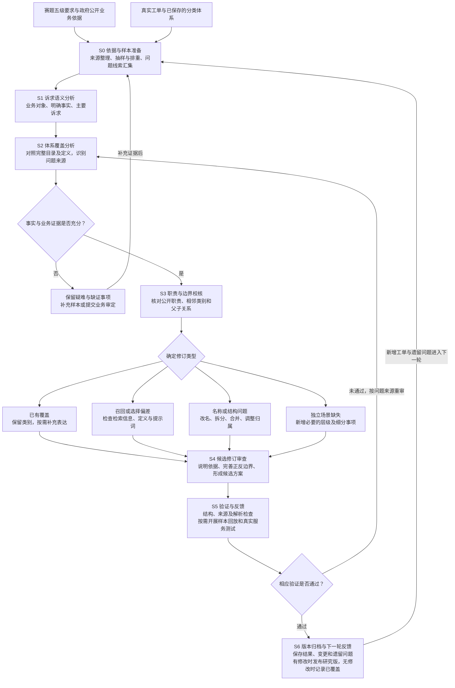

# 12345热线五级分类体系构建依据与数据驱动优化报告

[仓库首页](README.md) · [建设报告](12345热线五级分类体系建设报告.md) · [迭代流程图](分类体系构建与迭代流程图.md) · [参考来源](参考来源与引用说明.md)

编制日期：2026年10月28日；修订日期：2026年10月29日  
项目：基于多模型协同与层级约束的12345热线五级分类体系构建及智能优化

## 一、建设思路与技术路线

本项目围绕“一级行业职能—二级处室职责—三级诉求事项—四级表现情形—五级细分事项”建立分类标准。建设方法是将制度与职责依据、真实诉求证据、语义分析和程序验证结合起来：从公共业务的职责范围确定上层结构，从真实工单中识别事项与具体表现，再通过覆盖分析、边界校核和样本回放持续完善目录。

体系建设采用**多阶段大模型辅助审校框架**，以S0—S6组织数据准备、诉求理解、覆盖判断、职责校核、候选审查、验证反馈和版本归档。大模型辅助完成语义归纳与问题发现；语义审阅结合原文和业务资料确定修订方案；程序完成来源关联、结构检查、检索回放与结果留存。各阶段围绕同一条证据链衔接：

> 真实工单及业务依据 → 诉求与问题判断 → 类别修改及边界说明 → 验证结果 → 版本与下一轮问题清单。

迭代对象包括五级路径、类别名称、定义、纳入与排除范围、检索表达及职责映射。目标是让同类诉求得到一致表达，让相邻类别具有可解释的区别，让新场景能够进入已有结构。

本报告以2026年10月29日的869条路径为统计基准，结合第4轮、第6轮、第12轮和第13轮的原始记录，说明这一过程如何实际开展。案例中的工单内容采用脱敏概括，记录号用于回查证据。

## 二、构建依据与数据基础

### 2.1 三类依据共同约束分类设计

| 依据 | 采用的材料 | 在体系中的作用 |
|---|---|---|
| 任务与层级依据 | [赛题四技术答疑材料](<datas/组委会/赛题四：基于大模型的12345热线五级分类体系(3).docx>)、[五级分类讨论](datas/讨论/26.10.27五级分类讨论.pdf) | 确定五级语义，校正“仅按主题分类”与职责导向之间的偏差 |
| 制度与职责依据 | 接诉即办条例、政府机构职能、内设机构职责和办事指南 | 确定公共业务范围、二级职责名称与相邻事项边界 |
| 真实业务依据 | 北京、三亚、上海、福州的公开诉求与热线数据 | 识别群众表达方式、常见事项、长尾场景及具体办理障碍 |

[《北京市接诉即办工作条例》](https://zwfwj.beijing.gov.cn/zwgk/2024zcwj/202405/t20240510_3670139.html)为职责导向、派单目录维护及职责协调提供制度背景；[北京12345年度数据分析报告](https://www.beijing.gov.cn/hudong/jpzt/2025ndsjbg/index.html)用于参照业务名称、检查重要领域的覆盖情况。具体五级划分由工单事实、业务差异与职责依据共同确定。

[部门来源索引](datas/data1/各部门的真实处室的来源.pdf)和[部门处室及来源整理](datas/data1/各部门的真实处室以及该信息的来源.pdf)构成职责检索入口。核查时进一步读取具体部门、处室、事业单位或办事机构的业务说明，将真实机构资料关联到标准职责。

### 2.2 数据规模及分工

| 数据集 | 原始记录数 | 主要用途 |
|---|---:|---|
| sanya12345_dataset.csv | 184,568 | 大规模主题发现、办理障碍与长尾场景挖掘 |
| [北京市委书记留言板.xlsx](datas/data1/北京市委书记留言板.xlsx) | 3,204 | 北京本地事项与跨部门诉求分析 |
| [北京市市长留言板.xlsx](datas/data1/北京市市长留言板.xlsx) | 1,191 | 北京场景补充、业务表达与边界校准 |
| [北京领导留言板_样本.xlsx](datas/data1/北京领导留言板_样本.xlsx) | 2,585 | 历史审校及北京场景回查 |
| [北京公开来信](datas/data2/beijing_12345_public_letters.csv) | 212 | 资格、材料、办理流程及公共服务咨询 |
| [福州公开诉求](datas/data2/fuzhou_12345_public_350100.csv) | 701 | 跨城市场景与细分办理事项补充 |
| [上海公开诉求](datas/data2/shanghai_12345_public.csv) | 7,248 | 多领域场景及相邻业务边界补充 |
| **合计** | **199,709** | **原始文件记录总量** |

三亚数据来源于[北京大学开放研究数据平台](https://opendata.pku.edu.cn/dataset.xhtml?persistentId=doi:10.18170/DVN/XU3Q4W)；北京书记、市长留言分别对应[书记入口](https://liuyan.people.com.cn/threads/list?fid=539)与[市长入口](https://liuyan.people.com.cn/threads/list?fid=540)。其余数据来源见文末参考资料。

数据采用两种互补方式使用：分来源抽样观察通常场景，主题检索深入核查已经发现的问题。例如第4轮从北京书记、市长、三亚分别抽取75、75、150条，共300条；第12轮围绕出生证明、失业保险、劳动仲裁等主题抽取134个样本条目；第13轮围绕会计、社保卡、异地就医及妇幼服务继续审阅。

跨城市数据提供可复用的业务场景，北京公开职责资料用于校准职责表达。类别名称保留业务对象与办理需求，去除不影响归类的城市、单位个名、具体金额和历史时间条件。

## 三、五级结构及类别表示

### 3.1 每个层级承担不同的信息

| 层级 | 核心问题 | 设计原则 |
|---|---|---|
| 一级行业职能 | 属于哪个公共业务领域？ | 保持稳定行业范围，避免同义领域并列 |
| 二级处室职责 | 对应什么有依据的公共管理或服务职责？ | 用标准职责表达，并关联真实机构与业务来源 |
| 三级诉求事项 | 群众正在办理或要求解决什么事项？ | 围绕稳定业务对象组织 |
| 四级表现情形 | 该事项处于什么问题或办理情形？ | 体现业务差异，避免所有事项套用同一组通用词 |
| 五级细分事项 | 在该情形下需要进一步区分什么？ | 依据事实可判断，与兄弟类别边界清晰 |

例如当前体系中：

```text
卫生健康管理
└─ 妇幼健康管理职责
   └─ 出生医学证明办理
      ├─ 首次签发条件与受理问题
      │  └─ 出生医学证明首次申领及受理诉求
      └─ 证件补发及信息更正换发
         ├─ 出生医学证明遗失补发咨询诉求
         └─ 出生医学证明信息更正及换发诉求
```

三级保留共同办理对象；四级区分首次签发和后续证件处理；五级进一步区分遗失补发与信息更正。结构扩展遵循业务差异，优先复用已有父节点。单支节点作为结构复查线索，结合语义决定保留或重组。

### 3.2 路径、解释与职责证据协同维护

| 信息 | 技术作用 |
|---|---|
| 类别ID与五级path | 唯一定位类别，支持合法路径解析与版本差异比较 |
| definition、include、exclude | 说明业务定义、适用范围和相邻类别排除边界 |
| 示例与关键词 | 表达真实口语及业务别名，辅助语义理解与检索 |
| duty_catalog | 按行业和职责组织机构、来源及适用范围 |
| standardized_duty_id及独立职责维度 | 连接类别与标准职责，支持职责的一致维护 |

这样，分类名称保持简洁，判断依据保存在定义与证据中。二级职责可以关联部门、内设机构或承担相关职能的公共服务单位；实际承办关系另结合属地和事项确定。

## 四、S0—S6构建与迭代流程

下图与独立《分类体系构建与迭代流程图》保持一致。



### S0 依据与样本准备

**输入：** 赛事定义、公开职责资料、原始工单、当前目录、历史样本和问题记录。

整理数据来源与字段，结合分来源抽样、主题检索和疑难样本回查形成研究批次。工单以文件名、逻辑记录号、编号和正文指纹关联原始数据；抽样记录保留主题、种子及排重范围。上一轮留下的职责疑问、混合类别和弱覆盖事项也进入本轮线索。

**输出：** 有来源的样本集合、相关资料和待核查问题，作为S1理解诉求的基础。

### S1 诉求语义分析

**输入：** 标题、正文、原三级标签、承办单位等背景信息。

从正文中提取业务对象、已发生事实、办理状态和明确请求。标题与旧标签用于辅助理解，判断以正文证据为主。对于多诉求工单，分别识别具有独立业务意义的事项；对于回复中提到的办理建议，区分其与群众当前请求的关系。

例如“拖欠工资，咨询劳动仲裁需要什么材料”包含欠薪背景，但当前办理对象是仲裁申请。若只是催讨工资，回复建议申请仲裁，则仍需围绕追薪诉求判断。

**输出：** 对象、事实、诉求及歧义说明，为S2提供可与分类目录对照的语义单元。

### S2 体系覆盖分析

**输入：** 诉求语义单元、现有目录及类别定义。

先检查相关候选，再对可能缺口扩大到完整目录及相邻分支，识别问题来源：已有覆盖、检索或选择偏差、名称与结构问题、独立场景缺失。事实不足的记录保留疑问，并回到S0补充资料。

大模型审校用于批量发现线索。例如第4轮将工单与规则召回候选交给模型，返回覆盖状态和理由；随后对可能缺口重新检查完整目录。这样既能利用模型发现新表达，也能避免将漏召回误当成缺类。

**输出：** 覆盖判断和问题清单，明确S3应核对的职责、父节点与相邻类别。

### S3 职责与边界校核

**输入：** 待处理事项、相关路径、五级定义、政府公开职责及办事资料。

从三个角度核对：职责是否有依据，父子关系是否符合层级语义，相邻类别能否根据工单事实区分。核对后的事项分别进入四类处理分支：保留已覆盖类别；修正检索或选择偏差；调整名称和结构；补充独立缺失场景。

以会计服务为例，继续教育、考试报名和合格证书领取虽然共享“会计”主题，但对应不同业务环节。职责核查后，继续教育与报名归财政会计管理，证书领取关联人事考试服务，避免用主题词替代职责判断。

**输出：** 修订类型、归属依据及相邻边界，进入S4形成方案。

### S4 候选修订审查

**输入：** 经过核查的问题、真实样本和职责依据。

形成可核对的修改前后方案。新增类别优先复用现有父节点；混合类别通过收窄或拆分形成清楚边界；重复类别结合业务对象和处理需求考虑合并。新增类别同时检查相邻旧类，补充双向排除条件。

候选方案记录类别ID、修改前后path、定义变化、采用的工单和来源。旧ID保留而业务范围改变时，明确其语义迁移关系，便于后续回查历史结果。无需修改的事项保留“已覆盖”结论。

**输出：** 候选目录、变更清单、正例和反例，为S5确定验证范围。

### S5 验证与反馈

**输入：** 候选目录、变更清单、相关样本和旧版结果。

根据修改内容开展结构、职责来源、解析兼容和样本验证。结构检查覆盖ID唯一、五级非空、完整路径重复及职责映射一致性；样本检查覆盖新增事项、易混反例和历史类别；涉及检索或模型选择时，进一步开展候选回放或真实服务对照。

检查未通过，按问题来源返回S2重新判断，必要时补充S0资料或调整S3边界。第4轮的收养落户误选、第12轮的关键词失配，均通过这一反馈过程完成修订与复验。

**输出：** 检查结果、错误原因及复验结论；通过的结果进入S6。

### S6 版本归档与下一轮反馈

**输入：** 验证结果、候选目录和遗留问题。

保存修改前快照、候选及发布记录、来源证据、变更和验证结果。有修改时形成研究版本；没有修改时保存已覆盖记录。未解决事项作为下一轮定向抽样的输入，实现从结果到新一轮数据准备的衔接。

第12轮将会计继续教育的职责归属保留为待查问题，第13轮围绕该问题补充样本、核对财政和人社资料并完成调整，体现了跨轮闭环。

### 阶段间信息如何传递

| 阶段 | 关键输入 | 核心产出 | 承接关系 |
|---|---|---|---|
| S0 | 数据、来源、历史问题 | 样本及证据索引 | S1据此理解原文 |
| S1 | 工单事实与背景 | 对象、状态、请求、歧义 | S2对照目录 |
| S2 | 诉求与完整目录 | 覆盖情况及问题来源 | S3核查归属与边界 |
| S3 | 职责资料、相邻类别 | 有依据的处理类型 | S4形成候选 |
| S4 | 修改依据与方案 | 候选、差异、正反例 | S5确定检查对象 |
| S5 | 候选与验证样本 | 通过结论或失败原因 | 通过到S6，失败回S2 |
| S6 | 结果与遗留问题 | 版本和下轮线索 | 回到S0继续迭代 |

## 五、案例一：婚姻与收养混合类别的拆分及边界复验

本案例来自2026年10月28日第4轮。该轮以300条分来源样本开展六批模型审校，并结合主题检索补充证据，最终新增10条路径、修订7个已有类别，路径总数由829增至839。

### 5.1 从真实工单识别不同办理对象：S0—S2

| 三亚数据逻辑记录号 | 工单所支持的事项 | 原目录问题 |
|---|---|---|
| 9411 | 结婚登记办理 | 与收养业务共用混合叶 |
| 111309 | 儿童收养登记 | 独立办理对象未被清楚表达 |
| 44417、98794 | 婚姻证件遗失补领 | 与一般登记流程混在一起 |
| 15880 | 婚姻登记档案核验 | 档案信息问题需要明确边界 |
| 75602 | 收养背景下的户口办理 | “收养”只是背景，当前事项是落户 |

通过原文与完整目录对照，识别出两类问题：婚姻与收养属于不同业务，需拆开归属；婚姻登记内部存在补领、档案核验等需要明确表达的办理情形。

### 5.2 核对职责并形成候选：S3—S4

[北京市民政局社会事务管理处职责](https://mzj.beijing.gov.cn/art/2024/4/29/art_313_290394.html)提供婚姻登记管理依据，[儿童福利处职责](https://mzj.beijing.gov.cn/art/2024/4/29/art_313_290384.html)提供儿童收养业务依据。由此收窄原混合类别，新增独立的儿童收养登记路径，并在婚姻登记下补充共同四级与两个细项：

```text
民政与残疾人服务 > 儿童收养登记管理职责 > 儿童收养登记
> 收养资格与登记手续问题 > 儿童收养条件材料及登记办理

民政与残疾人服务 > 婚姻登记管理职责 > 婚姻登记事项
> 婚姻证件补领与登记档案问题
  ├─ 婚姻登记证件遗失补领咨询
  └─ 婚姻登记档案核验及信息不一致
```

### 5.3 用反例发现边界问题，再返回修订：S5—S6

该轮17条定向样本的首次候选回放中，16条符合审校期望；记录75602被误选为儿童收养登记。复查发现，模型被背景词“收养”吸引，忽略了当前请求是户口办理。

处理时返回S2重新判断主诉求，再在S3—S4完善收养与户政的双向边界：办理收养登记手续进入收养类；收养关系作为背景、实际申请落户的进入户政类。重新回放后，17条均符合开发期望，75602恢复为户口办理类别。

本例展示了“真实场景拆分—职责依据校核—反例发现问题—边界修改—复验归档”的完整闭环。证据保存在该轮 `boundary_comparison.json`、`changes.json` 和原文核验记录中。

## 六、案例二：出生医学证明场景补充与检索表达优化

本案例来自第12轮。该轮按主题扫描三亚数据并审阅134个主题样本条目，围绕失业保险、劳动仲裁、出生证明等新增10条路径。

### 6.1 工单事实如何形成三级至五级：S0—S4

| 逻辑记录号 | 原文事实的脱敏概括 | 抽象出的事项 |
|---|---|---|
| 12814 | 新生儿出生后咨询出生证明办理流程 | 首次申领 |
| 121469、29214 | 出生证明遗失，询问补办方式 | 遗失补发 |
| 102060 | 出生证登记姓名与身份证姓名存在差异，询问更改 | 信息更正 |
| 135939 | 父亲证件类型变化，询问出生证明信息如何修改 | 信息更正及换发 |

语义分析保留共同对象“出生医学证明”，区分首次申领、遗失和信息变更。对照[北京市出生医学证明管理通知](https://wjw.beijing.gov.cn/zwgk_20040/ylws/202304/t20230420_3061442.html)及相关办事资料，在妇幼健康职责下形成第三章所示的三级事项、两个四级情形和三个五级细项。

同时，原“生育登记准生证办理咨询”调整为“生育登记条件材料及办理咨询”，保留“准生证”等口语检索表达，明确其与出生医学证明及公安户口登记的区别。这样既丰富了类别，也校正了相邻旧类。

### 6.2 已有类别仍需检索可达：S5反馈到S2—S4

初次对本轮29条开发正例做规则回放，17条的目标路径进入前20候选。检查发现部分关键词写得过长：工单将“出生证”和“修改”分开表达时，无法匹配连续的“出生证姓名更改”。

该问题被判为检索表达问题，处理方式是补充业务词及必要词组约束，使定义与检索文本同时覆盖口语表达。调整后，29条目标路径均进入前20候选，另以8条反例审阅户政、挂号、失物、医保等边界。

这一轮没有为了修复漏召回继续添加相似类别，而是根据问题来源优化原有表达。验证记录随861条候选目录归档，会计等尚待核查问题进入下一轮。

## 七、案例三：会计服务从遗留问题到职责与事项重组

本案例连接第12轮与第13轮，体现S6回到S0的持续迭代。

### 7.1 上一轮遗留问题转化为定向样本：S6→S0

第12轮发现“会计继续教育及从业资格证咨询”混合了继续教育、考试和证书业务，且笼统归在人社就业服务下。问题记录进入第13轮，围绕会计、社保卡、异地就医及妇幼主题开展定向审阅。第13轮实际阅读条目经正文归一排重后为118条，形成38条明确开发正例、8条反例和1条歧义记录。

### 7.2 从主题相同转向办理环节不同：S1—S2

| 来源与逻辑记录号 | 工单内容概括 | 当前办理对象 |
|---|---|---|
| 三亚29187、82370；福州146 | 继续教育何时开课、在哪里参加 | 课程参与及学分政策 |
| 三亚69377、159741 | 继续教育信息提交受阻、查询审核部门或状态 | 材料提交与审核 |
| 三亚39295、69346、76194 | 初级会计考试如何报名、需要什么材料 | 考试报名 |
| 福州192 | 通过考试后未领证，询问邮寄领取 | 合格证书发放 |

这些样本共享“会计”主题，但处理环节与请求不同。原类别的宽泛名称不能清晰表达上述差异，需要同时调整职责归属与下层事项。

### 7.3 用职责资料约束归属：S3—S4

依据[北京市财政局会计处职责](https://czj.beijing.gov.cn/zwxx/jgjj/nsjg/201912/t20191209_974896.html)、[会计继续教育通知](https://czj.beijing.gov.cn/zwxx/tztg/202604/t20260407_4574966.html)和[考试报名通知](https://czj.beijing.gov.cn/zwxx/tztg/202512/t20251225_4362451.html)，将继续教育与考试报名组织到财政会计管理职责；依据[人事考评办公室证书发放通知](https://rsj.beijing.gov.cn/ywsite/bjpta/kszl/zscx/202609/t20260920_4871766.html)，将合格证书领取归入人事考试服务。

| 处理 | 当前五级路径 |
|---|---|
| 原类别改名、收窄及调整归属 | 财政管理 > 会计管理职责 > 会计人员服务 > 继续教育参与及学分认定咨询 > 会计人员继续教育课程及学分政策咨询 |
| 新增审核情形 | 财政管理 > 会计管理职责 > 会计人员服务 > 继续教育信息提交及审核异常 > 会计继续教育材料提交及审核进度问题 |
| 新增报名情形 | 财政管理 > 会计管理职责 > 会计人员服务 > 专业技术资格考试报名需求 > 会计专业技术资格考试报名条件材料咨询 |
| 新增证书领取事项 | 人力资源社会保障 > 人事考试服务职责 > 专业技术资格证书服务 > 考试合格证书申领与寄送问题 > 会计专业技术资格证书领取及邮寄咨询 |

同时使用“持会计证申请落户”“持证申请技能补贴”等反例明确边界：证书只是资格背景时，应依据当前办理的落户或补贴事项归类。

### 7.4 验证与版本反馈：S5—S6

第13轮对47条选定证据回读原文件核对正文指纹；38条开发正例的目标路径全部进入规则前20候选，上一轮29条样本保持29/29。869条路径通过五级完整性、唯一性及现有解析器检查。

该轮共新增8条路径、修改12个已有类别，体系由861条增至869条。会计问题完成归属与事项重组；跨省就医状态不明等个别记录继续保留补证。修改、验证和遗留事项分别进入版本记录和下一轮队列。

## 八、保留与归属校正同样是迭代成果

体系优化既包括扩展，也包括对已覆盖业务的确认，以及职责表达的校正。

第6轮审阅34条教育路径，结合7个官方网页调整12条路径的二级职责，五级总数保持839条。例如学校收费、学生资助原先均放在“学校管理职责”，根据[北京市教委财务处职责](https://jw.beijing.gov.cn/xxgk/zfxxgkml/zwgkjgzn/zwgknsjg/202001/t20200108_1568849.html)，分别明确为“教育收费管理职责”和“学生资助管理职责”。业务叶子、定义和示例保留，通过职责映射提高上层表达的准确性。

第13轮三亚18013只反映跨省已经申报、医院端未显示，无法仅凭文本判断是备案问题还是结算同步问题。该记录进入歧义清单，通过补充事实再决定归属，对应流程图的“事实与业务证据是否充分”分支。

这两类处理使目录保持适度稳定：有真实业务差异时细化，有充分覆盖时复用，信息不足时补证。

## 九、验证组织与阶段成果

### 9.1 分层验证

| 验证层 | 主要检查 | 结果用途 |
|---|---|---|
| 结构与映射 | 五级完整、ID与path唯一、职责引用及计数一致 | 保证目录结构可维护 |
| 语义与来源 | 工单事实、职责资料、相邻边界、正反例 | 支持类别修订的业务合理性 |
| 解析与候选回放 | 合法路径解析、目标类别是否进入候选 | 检查体系与推理组件的兼容性 |
| 模型样本回放 | 固定样本与候选下的模型选择、错误原因及复验 | 检查边界表达对分类行为的影响 |

### 9.2 代表性轮次结果

| 轮次 | 数据及动作 | 体系变化 | 验证结果 |
|---|---|---|---|
| 第4轮真实数据审校 | 300条分来源样本，六批模型审校，补充主题证据 | 829→839；新增10条，修订7个已有类别 | 17条定向回放从16条符合期望到17条；839条路径解析通过 |
| 第6轮教育职责 | 34条路径、7项官方来源，校正12条职责归属 | 839→839 | 路径及职责映射检查通过，原业务字段保留 |
| 第12轮非交通扩展 | 134个主题样本条目，29条引用证据核验 | 851→861；新增10条，修订8个已有类别 | 规则前20命中由17/29到29/29，861条路径解析通过 |
| 第13轮会计与健康服务 | 118条正文归一后阅读记录，47条证据核验 | 861→869；新增8条，修订12个已有类别 | 本轮38/38、上一轮29/29进入规则前20，869条路径解析通过 |

**统计口径。** 原始数据量是文件记录数，存在跨文件重复；检索扫描量、实际阅读量和采用证据量分别统计。模型初筛属于问题线索：第4轮的200条已覆盖、35条边界问题、61条可能缺口、4条信息不足，经完整目录复查后形成上述修订。定向回放属于开发验证，规则前20命中表示候选可达，路径解析通过表示结构兼容；分类准确率需另用经过审定的独立样本衡量。第4轮包含真实模型调用，第6、12、13轮以语义审阅、公开资料核查及相应程序检查推进。

## 十、当前体系统计与证据管理

### 10.1 层级数量

按完整父路径去重统计，同名节点处于不同父路径时分别计数。

| 层级 | 节点数 |
|---|---:|
| 一级行业职能 | 23 |
| 二级处室职责 | 237 |
| 三级诉求事项 | 387 |
| 四级表现情形 | 492 |
| 五级细分事项路径 | 869 |

其中业务路径868条，人工复核路径1条，完整路径重复数为0。237个行业—职责分组中，137组保存公开来源引用，引用网址去重后为128个；来源用于逐步完善职责证据。

### 10.2 各行业覆盖

| 一级行业职能 | 五级路径数 |
|---|---:|
| 住房城乡建设 | 73 |
| 市场监管与知识产权 | 88 |
| 公安政法 | 47 |
| 城市管理 | 64 |
| 生态环境保护 | 33 |
| 交通运输管理 | 159 |
| 人力资源社会保障 | 45 |
| 卫生健康管理 | 46 |
| 综合受理 | 1 |
| 教育管理 | 34 |
| 自然资源规划 | 28 |
| 文化旅游体育 | 31 |
| 农业农村管理 | 28 |
| 公用事业服务 | 36 |
| 医疗保障管理 | 10 |
| 民政与残疾人服务 | 27 |
| 退役军人服务 | 3 |
| 政务服务管理 | 61 |
| 应急消防管理 | 20 |
| 商务管理 | 3 |
| 税务管理 | 22 |
| 财政管理 | 3 |
| 金融服务管理 | 7 |
| **合计** | **869** |

### 10.3 证据与版本的对应关系

| 记录 | 保存的信息 | 对应阶段 |
|---|---|---|
| 抽样及来源清单 | 数据集、主题、记录号、抽样方法和指纹 | S0 |
| 语义审阅及模型审校结果 | 原文事实、诉求、覆盖判断及理由 | S1—S2 |
| 官方来源及职责映射 | 来源页面、机构职责、业务适用范围 | S3 |
| 修改前快照、候选和变更清单 | 新旧路径、定义与边界变化 | S4 |
| 解析、候选和边界回放记录 | 检查条件、结果和失败原因 | S5 |
| 发布与后续问题记录 | 版本、变更摘要、遗留事项 | S6 |

本报告案例对应的过程档案为：`taxonomy_v2_data_review_20261028`、`taxonomy_v2_education_duties_20261028`、`taxonomy_v2_nontransport_round12_20261028`、`taxonomy_v2_accounts_health_round13_20261029`。其中 `changes.json` 保存逐项差异，`sources.json` 保存来源，`validation.json` 保存检查结果，边界回放及正反例文件保存判断证据。这些记录将每次修订与真实数据、业务依据和验证结果联系起来。

文中的五级路径已与当前869条目录逐项核对；流程图、阶段定义及统计与[建设报告](12345热线五级分类体系建设报告.md)和[独立流程图](分类体系构建与迭代流程图.md)采用一致口径。

<a id="reference-sources"></a>

## 参考文献与来源

以下直接列出本报告引用的数据平台、政府职责资料和具体业务文件，供读者核查。数据出处支持样本来源说明，职责及办事资料支持业务归属与分类边界，项目实验结论则由相应验证记录支持。核对日期为2026年10月29日。

### 参考资料一 真实数据来源

以下入口用于追溯原始诉求及数据集出处。

| 来源及入口 | 对应本地数据  |
|---|---|
| [北京书记留言板](https://liuyan.people.com.cn/threads/list?fid=539) | [北京市委书记留言板.xlsx](datas/data1/北京市委书记留言板.xlsx)  |
| [北京市长留言板](https://liuyan.people.com.cn/threads/list?fid=540) | [北京市市长留言板.xlsx](datas/data1/北京市市长留言板.xlsx)  |
| [三亚12345研究数据](https://opendata.pku.edu.cn/dataset.xhtml?persistentId=doi:10.18170/DVN/XU3Q4W) | sanya12345_dataset.csv（未上传，可从来源入口获取） |
| [上海12345诉求公开](https://www.sh12345.gov.cn/#/demands) | [shanghai_12345_public.csv](datas/data2/shanghai_12345_public.csv)  |
| [福州12345诉求公开](https://fz12345.fuzhou.gov.cn/#/fujianAppealPubilc?rigion=publish) | [fuzhou_12345_public_350100.csv](datas/data2/fuzhou_12345_public_350100.csv)  |
| [北京首都之窗公开信件](https://www.beijing.gov.cn/hudong/hdjl/sindex/hdjl-xjxd.html) | [beijing_12345_public_letters.csv](datas/data2/beijing_12345_public_letters.csv) |


### 参考资料二 政府机构与职责资料


| 部门或材料 | 原始公开入口  |
|---|---|
| 北京市交通委员会 | [公开资料](https://jtw.beijing.gov.cn/xxgk/jgzn/jgsz/)  |
| 北京市市场监督管理局 | [公开资料](https://scjgj.beijing.gov.cn/jgzq/)  |
| 北京市卫生健康委员会 | [公开资料](https://wjw.beijing.gov.cn/wjwh/ztzl/zqgs_1/nsjg/)  |
| 北京市人力资源和社会保障局 | [公开资料](https://rsj.beijing.gov.cn/xxgk/zfxxgk/jgxx/)  |
| 北京市民政局 | [公开资料](https://mzj.beijing.gov.cn/col/col243/index.html)  |
| 北京市公安局 | [公开资料](https://gaj.beijing.gov.cn/zfxxgk/jgzn/202001/t20200102_1554557.html)  |
| 北京市规划和自然资源委员会 | [公开资料](https://ghzrzyw.beijing.gov.cn/zhengwuxinxi/jggk/nsjg/)  |
| 北京市教育委员会 | [公开资料](https://jw.beijing.gov.cn/xxgk/zfxxgkml/zwgkjgzn/zwgknsjg/)  |
| 北京市城市管理委员会 | [公开资料](https://csglw.beijing.gov.cn/zwxx/jgzn/zqxx/bjsszsrglwyh/nsjg/)  |
| 北京市生态环境局 | [公开资料](https://sthjj.beijing.gov.cn/bjhrb/index/xxgk69/zfxxgk43/fdzdgknr2/zqxx84/nsjg/index.html)  |
| 北京市农业农村局 | [公开资料](https://nyncj.beijing.gov.cn/nyj/zwgk/jgzn/jgsz/index.html)  |
| 北京市文化和旅游局 | [公开资料](https://whlyj.beijing.gov.cn/zfxxgkpt/zdgk/jgzn/nsjg/)  |
| 北京市体育局 | [公开资料](https://tyj.beijing.gov.cn/bjsports/jgzz17/458329/index.html)  |
| 北京市应急管理局 | [公开资料](https://yjglj.beijing.gov.cn/col/col2492/index.html)  |
| 北京市政务服务和数据管理局 | [公开资料](https://zwfwj.beijing.gov.cn/zwgk/qzxx/jgsz/)  |
| 北京市园林绿化局 | [公开资料](https://yllhj.beijing.gov.cn/zwgk/jgzn/nsjg/)  |
| 北京市医疗保障局 | [公开资料](https://ybj.beijing.gov.cn/zwgk/2020_zfxxgk/2020_jgjj/)  |
| 北京市水务局 | [公开资料](https://swj.beijing.gov.cn/zwgk/jgxx/nsjg/)  |
| 国家税务总局北京市税务局 | [公开资料](http://beijing.chinatax.gov.cn/bjswj/c105838/202104/3a05462b142b472895c75c3e78392d0f.shtml)  |
| 原北京市地方金融监督管理局 | [公开资料](https://www.beijing.gov.cn/gongkai/caizheng/czzt/2022js/202308/t20230825_3230579.html)  |
| 北京市退役军人事务局 | [公开资料](https://tyjrswj.beijing.gov.cn/zwgk/nsjg/)  |
| 北京市商务局 | [公开资料](https://sw.beijing.gov.cn/zt/zqxx/nsjg/)  |


### 参考资料三 制度与具体业务依据

| 资料 | 支持的论述 |
|---|---|
| [北京市接诉即办工作条例](https://zwfwj.beijing.gov.cn/zwgk/2024zcwj/202405/t20240510_3670139.html) | 职责导向、派单目录及动态维护的制度背景 |
| [北京12345年度数据分析报告](https://www.beijing.gov.cn/hudong/jpzt/2025ndsjbg/index.html) | 重要民生领域及业务名称参照  |
| [北京市财政局会计处职责](https://czj.beijing.gov.cn/zwxx/jgjj/nsjg/201912/t20191209_974896.html) | 会计人才及资格管理的职责线索  |
| [2026年会计人员继续教育通知](https://czj.beijing.gov.cn/zwxx/tztg/202604/t20260407_4574966.html) | 课程、学分及审核事项的区分 |
| [会计资格考试报名通知](https://czj.beijing.gov.cn/zwxx/tztg/202512/t20251225_4362451.html) | 考试报名与继续教育、领证分开表达 |
| [会计初级资格证书发放通知](https://rsj.beijing.gov.cn/ywsite/bjpta/kszl/zscx/202609/t20260920_4871766.html) | 人事考评办公室的发证服务依据 |
| [社会保障卡常态化换发通知](https://rsj.beijing.gov.cn/xxgk/tzgg/202601/t20260104_4395898_ext.html) | 申领、补换及制卡进度业务区分  |
| [异地就医网上备案流程](https://ybj.beijing.gov.cn/2020_zwfw/2020_cjwt/202107/t20210713_2434753.html) | 备案申请与报销结算分开表达  |
| [北京线上孕妇学校资料](https://wjw.beijing.gov.cn/xwzx_20031/jcdt/202002/t20200217_1647160.html) | 孕产健康教育课程是独立服务事项 |
| [辅助生殖技术质量管理资料](https://wjw.beijing.gov.cn/xwzx_20031/jcdt/202510/t20251023_4236581.html) | 辅助生殖具有独立技术服务范围  |

具体业务资料与类别的对应关系保存在职责目录和各轮来源记录中，可结合本文案例核查。
